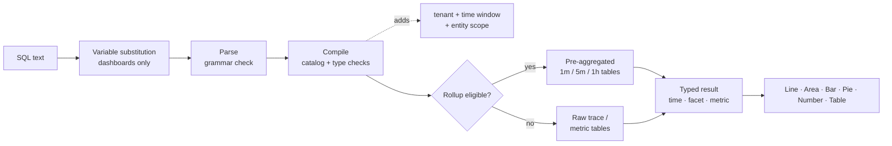

<a id="top"></a>

# Dashboard & Query Language

**Adobe Observability Insights Query Language (SQL)** — query, chart and dashboard your telemetry in Adobe Observability Insights.

|                |                                                                  |
| -------------- | ---------------------------------------------------------------- |
| **Applies to** | Insights UI → **Explore** and **Dashboards** (custom dashboards) |
| **Audience**   | Engineers, SREs and power users who know SQL                     |

> [!TIP]
> Every code block marked `sql` is a SQL query that you can paste straight into **Explore → SQL** or into **Dashboards → Add widget → SQL**.

---

## Documentation map

| Section         | Doc                                                                                 | What you'll learn                                                                           |
| --------------- | ----------------------------------------------------------------------------------- | ------------------------------------------------------------------------------------------- |
| **Get started** | [1. Get started with SQL](#get-started-with-sql-the-language-of-your-telemetry)   | What SQL is, what you can query, where to use it, the basic rules                           |
|                 | [2. How to query with SQL](#how-to-query-with-sql-the-mechanics-of-querying)      | How to explore data, how a query runs, worked examples                                      |
|                 | [3. Charts and dashboards](#charts-and-dashboards-visualizing-your-data)          | How to turn queries into charts and build dashboards step by step                           |
| **Reference**   | [4. SQL reference](#sql-reference)                                                | Every clause, function and operator, with examples                                          |
|                 | [5. Data dictionary](#data-dictionary)                                            | Every entity and attribute you can query                                                    |
| **Tutorials**   | [6. Tutorial 1: Your first queries](#tutorial-1-your-first-queries)               | `SELECT`, `FROM`, `LIMIT`, aggregates, time, `TIMESERIES`, `WHERE`, `FACET`                 |
|                 | [7. Tutorial 2: Control your data](#tutorial-2-control-your-data)                 | Unique values, latest/earliest, percentages, percentiles, labels, wildcards, ordering       |
|                 | [8. Tutorial 3: Advance your dashboarding](#tutorial-3-advance-your-dashboarding) | Conditional aggregates, Apdex, rates, histograms, formulas, variables, sections             |
|                 | [9. Tutorial 4: Advanced functions](#tutorial-4-advanced-functions)               | `stddev`, `derivative`, ranked `latest`, share of total, span composition, metric discovery |
| **Examples**    | [10. Query cookbook](#query-cookbook)                                            | 100+ ready-to-use queries by topic (including AEM)                                          |
|                 | [11. Dashboard blueprints](#dashboard-blueprints)                                | Ten complete, complex dashboards with every widget's query                                  |
| **Operate**     | [12. Performance](#performance)                                                  | Rollups, query budgets and how to keep dashboards fast                                      |
|                 | [13. Troubleshooting](#troubleshooting)                                          | Every error message, what it means, and how to fix it                                       |
|                 | [14. Appendix](#appendix)                                                        | Limits, export file format, one-page cheat sheet                                            |

---

# Get started

## 1. Get started with SQL: the language of your telemetry {#get-started-with-sql-the-language-of-your-telemetry}

Insights Query language is a SQL-like query language for your Observability Insights data. It is the same language behind every custom dashboard widget and the **Explore** page, so you can build the views your team needs.

SQL works with **entities**, which are friendly logical views such as `Transaction`, `Span` or `CpuUtilization`. You never query storage tables directly. Observability Insights compiles each SQL query into a safe, parameterised warehouse query. It always scopes that query to your tenant and the selected time window.

```sql
SELECT count(*) AS requests FROM Transaction TIMESERIES AUTO
```

### What you can do with SQL

Use SQL to:

- **Build charts** of throughput, error rate, latency, Apdex, CPU, memory, JVM heap, disk and network over time.
- **Answer specific questions**, such as "which URL paths on the publish tier have the worst p95?" or "which downstream domain is failing?"
- **Investigate incidents** by drilling from a KPI down to individual requests and trace IDs.
- **Build dashboards** with KPIs, trends, tables, formulas, notes, section headers and variables.
- **Profile AEM workloads** (Adobe Experience Manager) using Sling, JSP, JCR, dispatcher and GraphQL attributes.

SQL supports both **event queries**, which return individual request rows, and **aggregate queries**, which return totals, percentiles, rates, breakdowns and time series.

> [!TIP]
> The templates in **Dashboards → Create dashboard** are built entirely from SQL. Open any template widget with the pencil icon to see, and learn from, its query.

### What you can query

SQL can query four families of data. The complete list is in the [Data dictionary](#data-dictionary).

| Family                               | Entities                                                                                                                                                           | Typical questions                                                    |
| ------------------------------------ | ------------------------------------------------------------------------------------------------------------------------------------------------------------------ | -------------------------------------------------------------------- |
| **Traces (APM)**                     | `Transaction` (inbound requests), `AppRequest` (requests + message consumers), `Span` (every span)                                                                 | Throughput, latency, errors, Apdex, downstream calls, AEM code paths |
| **Curated host and runtime metrics** | `CpuUtilization`, `MemoryUtilization`, `LoadAverage5m`, `DiskUtilization`, `NetworkReceiveRate`, `JvmHeapUsed`, `JvmThreadCount`, `DispatcherRequestRate` and more | Saturation, capacity, JVM health, dispatcher load                    |
| **Generic metrics**                  | `MetricGauge`, `MetricSum`                                                                                                                                         | Any OpenTelemetry metric by name, metric discovery                   |
| **Pre-aggregated span composition**  | `SpanBreakdown`                                                                                                                                                    | Which child operations make up a transaction                         |

> [!NOTE]
> Logs, alert definitions and inventory relationships aren't available.

### Where to use SQL

| Where                   | How to open it                                                                 | What it's for                                                                                                                                                                        |
| ----------------------- | ------------------------------------------------------------------------------ | ------------------------------------------------------------------------------------------------------------------------------------------------------------------------------------ |
| **Explore**             | Left navigation → **Explore**                                                  | Ad hoc analysis. Use the **Visual Builder** or the **SQL** tab, **Validate**, then **Run** (⌘/Ctrl + Enter). Includes **History** and **Saved** queries and a **Query guide** panel. |
| **Dashboards**          | Left navigation → **Dashboards** → open or create a dashboard → **Add widget** | Persistent charts, KPIs and tables, combined into dashboards.                                                                                                                        |
| **Formula widgets**     | **Add widget → Formula**                                                       | Combine 2–6 SQL queries with arithmetic (ratios, headroom, burn rates).                                                                                                              |
| **Dashboard variables** | **+ Variable → From a query**                                                  | Populate a picker from the distinct values of a SQL `FACET` query.                                                                                                                   |
| **Query inspection**    | Hover a chart → inspect query                                                  | See the SQL behind a built-in or dashboard chart.                                                                                                                                    |

### SQL query structure

SQL follows a clause-based syntax. This query counts all inbound requests in the selected window:

```sql
SELECT count(*) FROM Transaction
```

Here are all the available clauses:

```text
SELECT  function(attribute) [FILTER (WHERE condition)] [AS alias] [, ...]
        | attribute [AS alias] [, ...]
FROM    Entity
  [WHERE      condition [AND | OR ...]]
  [FACET      attribute [, attribute ...]]        -- up to 5
  [SINCE      n unit [AGO]]
  [UNTIL      NOW | n unit [AGO]]
  [TIMESERIES AUTO | MAX | n unit]
  [ORDER BY   alias [ASC | DESC]]
  [LIMIT      number]                              -- 1 to 5000
```

Here are the rules SQL follows:

| Rule                         | Details                                                                                                                                                                              |
| ---------------------------- | ------------------------------------------------------------------------------------------------------------------------------------------------------------------------------------ |
| **Required clauses**         | `SELECT` and `FROM` are required. Every other clause is optional. You can start with either: `FROM Transaction SELECT count(*)` is also valid.                                       |
| **Clause order**             | Clauses after `FROM` can appear in any order. Each clause may appear only once.                                                                                                      |
| **Query size**               | A query must be 4 KB or less.                                                                                                                                                        |
| **Case sensitivity**         | Keywords, function names, entity names and attribute names are **not** case sensitive. String values **are** case sensitive (`'Error'` ≠ `'error'`).                                 |
| **Strings**                  | Use single quotes: `WHERE status = 'Error'`. To include a quote, double it: `'O''Brien'`. Double quotes aren't accepted.                                                             |
| **Literals**                 | Strings, numbers (including negative and decimal), `TRUE`, `FALSE`, `NULL`.                                                                                                          |
| **Attribute names**          | Names can contain letters, digits, `_` and `.` (for example `http.statusCode`). No backticks are needed.                                                                             |
| **Aggregates vs attributes** | A query either selects raw attributes (an event list) or aggregates, never both. To group, use `FACET`.                                                                              |
| **Time window**              | The default is the last hour. The maximum is 31 days. On dashboards and in Explore, the **time picker** sets the window (see [Time window](#time-window-precedence)).                |
| **Not supported**            | Semicolons, comments, subqueries, joins, `SELECT *`, math between attributes in `SELECT`, `HAVING`, `COMPARE WITH`. See [What SQL doesn't do](#what-sql-doesnt-do) for alternatives. |

### Next steps

- [How to query with SQL](#how-to-query-with-sql-the-mechanics-of-querying): explore data and understand how queries run.
- [Charts and dashboards](#charts-and-dashboards-visualizing-your-data): visualize your results.
- [Tutorial 1: Your first queries](#tutorial-1-your-first-queries): a hands-on walkthrough.
- [SQL reference](#sql-reference): full syntax, clauses and functions.

[↑ Back to top](#top)

---

## 2. How to query with SQL: the mechanics of querying {#how-to-query-with-sql-the-mechanics-of-querying}

Before you use any tool, it helps to know how it works. This doc shows how to explore your data, explains what happens when a query runs, and walks through example queries from simple to complex.

### Data exploration

The best way to use SQL is to open **Explore** and try it on your own data.

> [!TIP]
> SQL is read-only. It can't change or delete data, and every query is scoped to your tenant.

1. **Pick a customer** in the tenant switcher at the top of the app, SQL needs a single tenant.
2. Open **Explore**. The **Visual Builder** tab lets you pick **From** (an entity), **Aggregate**, **Filters**, **Facet** and **Timeseries**. The generated SQL appears underneath.
3. Switch to the **SQL** tab to edit the query directly. The editor autocompletes entities, attributes and functions as you type.
4. Open the **Query guide** panel on the right to browse entities, attribute types and example queries. Click an example to load it.
5. Click **Validate** to check a query without running it, or **Run** (⌘/Ctrl + Enter) to see the results.

Start by typing `FROM` and choosing an entity, then add `SELECT` and an attribute:

```sql
FROM Transaction SELECT name, duration LIMIT 20
```

This is a basic **event query**. It returns 20 inbound requests, showing the operation name and duration of each one.

Now replace the attributes with an **aggregate** and group the result:

```sql
FROM Transaction SELECT count(*) FACET service
```

This counts requests per service, which shows you which services are reporting.

> [!IMPORTANT]
> **Discover before you build.** Attribute availability depends on how each service is instrumented. Run the [discovery queries](#101-data-discovery) on a new tenant first to see which services, hosts, attributes and metrics actually contain data.

### How a query runs

When you run a query, Observability Insights:

1. **Substitutes variables**, replacing `{{name}}` tokens with the current dashboard variable selection. This happens in the browser, on dashboards only.
2. **Parses** the text. Anything outside the SQL grammar is rejected, including semicolons, raw SQL functions and subqueries.
3. **Compiles** the query. It maps each logical attribute (for example `urlPath`) to its stored expression and validates types and functions.
4. **Adds mandatory guards**: your tenant, the time window, and the entity's fixed scope (for example, `Transaction` means server spans only).
5. **Routes** eligible time-series queries to pre-aggregated **rollup** tables. This is automatic, and the results match the raw data.
6. **Executes** the query with a 15-second timeout and a bytes-read budget, then returns typed columns (time, facet, metric) that the UI renders.



### Result shapes

Every query returns one of four shapes. The shape decides which charts make sense.

| Shape           | How you get it                                       | Default `LIMIT` | Best visualization |
| --------------- | ---------------------------------------------------- | --------------- | ------------------ |
| **Billboard**   | Aggregates only, with no `FACET` and no `TIMESERIES` | 1               | Number             |
| **Facet**       | Aggregates + `FACET`                                 | 10              | Bar, Pie, Table    |
| **Time series** | Aggregates + `TIMESERIES` (with or without `FACET`)  | 5,000 rows      | Line, Area, Bar    |
| **Events**      | Raw attributes only                                  | 100             | Table              |

<a id="time-window-precedence"></a>

### Time window precedence

| Where the query runs              | Which window applies                                                               |
| --------------------------------- | ---------------------------------------------------------------------------------- |
| **Dashboard widget**              | The dashboard **time picker**. `SINCE`/`UNTIL` in the query are ignored.           |
| **Add widget preview**            | The time picker inside the **Add widget** dialog.                                  |
| **Explore**                       | The global time picker. `SINCE`/`UNTIL` are ignored when a picker range is active. |
| **API without an explicit range** | `SINCE`/`UNTIL` in the query, defaulting to the last hour.                         |

> [!NOTE]
> Because the picker wins on dashboards and in Explore, this guide usually leaves `SINCE` out of dashboard queries. One should always define a time picker for the queries.

### SQL query examples

Here's a more complete example. For this query:

- You choose `Transaction` as the entity.
- You use `SELECT` to calculate the 95th percentile duration.
- You group the results by service with `FACET`.
- You use `TIMESERIES AUTO` to plot the data over an automatically sized interval.

```sql
FROM Transaction SELECT percentile(duration, 95) AS p95 FACET service TIMESERIES AUTO
```

This produces one line per service on a Line chart, with the 10 busiest services shown by default.

Click each example below to expand it.

<details>
<summary><strong>Basic query of inbound requests</strong></summary>

Average response time, in milliseconds, of all inbound requests:

```sql
SELECT average(duration) FROM Transaction
```

</details>

<details>
<summary><strong>Attribute names that contain dots</strong></summary>

Dotted names don't need quoting:

```sql
SELECT count(*) FROM Transaction WHERE http.statusCode >= 500 FACET http.route
```

</details>

<details>
<summary><strong>Query returning multiple columns</strong></summary>

Several aggregates in one query become columns in a Table:

```sql
SELECT count(*) AS requests, average(duration) AS avgMs, percentile(duration, 95) AS p95, max(duration) AS maxMs FROM Transaction FACET service
```

</details>

<details>
<summary><strong>Conditional aggregates in one pass</strong></summary>

Total, errors and 5xx side by side:

```sql
SELECT count(*) AS total, count(*) FILTER (WHERE status = 'Error') AS errors, count(*) FILTER (WHERE http.statusCode >= 500) AS http5xx FROM Transaction FACET service
```

</details>

<details>
<summary><strong>Querying a curated metric</strong></summary>

Average CPU per host over time:

```sql
SELECT average(value) AS cpu FROM CpuUtilization FACET host TIMESERIES AUTO
```

</details>

<details>
<summary><strong>Querying any OpenTelemetry metric by name</strong></summary>

Use `MetricGauge` / `MetricSum` for metrics without a curated entity:

```sql
SELECT latest(value) AS bytesUsed FROM MetricSum WHERE metric = 'jvm.memory.used' FACET host, pool
```

</details>

<a id="what-sql-doesnt-do"></a>

### What SQL doesn't do

SQL is deliberately small. That keeps queries safe, fast and tenant-isolated. When you need one of these capabilities, use the alternative.

| Capability                                  | Status        | Alternative                                                                                                  |
| ------------------------------------------- | ------------- | ------------------------------------------------------------------------------------------------------------ |
| `SELECT *`                                  | Not supported | List the attributes you want: `SELECT timestamp, name, duration, traceId …`.                                 |
| Mixing raw attributes and aggregates        | Not supported | Use `FACET attr`, or `latest(attr)` / `earliest(attr)`.                                                      |
| Math in `SELECT` (`a - b`, `count(*) / 60`) | Not supported | **Formula** widget (dashboards).                                                                             |
| Joins and subqueries                        | Not supported | **Formula** widget, or two widgets side by side.                                                             |
| `HAVING`                                    | Not supported | `ORDER BY alias` + `LIMIT`.                                                                                  |
| `COMPARE WITH`                              | Not supported | Change the time picker, or put two widgets on different tabs.                                                |
| `FACET CASES`                               | Not supported | One `count(*) FILTER (WHERE …)` column per case (see [Tutorial 3](#83-group-values-into-cases-with-filter)). |
| `histogram()`                               | Not supported | Bucketed `FILTER` columns (see [Tutorial 3](#84-build-a-latency-histogram)).                                 |
| `uniques()` / `keyset()`                    | Not supported | `FACET attr LIMIT n` lists distinct values. Discovery queries list metrics and populated attributes.         |
| `RLIKE` (regex)                             | Not supported | `LIKE` / `NOT LIKE` with `%` and `_` wildcards, or `IN (…)`.                                                 |
| Comments (`--`, `//`, `/* */`)              | Not supported | Put notes in the widget title or a **Text** widget.                                                          |
| Absolute dates in `SINCE`                   | Not supported | Use the time picker's absolute range.                                                                        |
| Type conversion (`numeric()`, `string()`)   | Not needed    | Attributes are typed in the catalog.                                                                         |

[↑ Back to top](#top)

---

## 3. Charts and dashboards: visualizing your data {#charts-and-dashboards-visualizing-your-data}

Queries find the information you need. Charts and dashboards make that information useful to your organization. This doc shows how SQL results become charts, and how to build, organize and share dashboards.

### Charts

Every SQL result can be rendered as one of six chart types.

| Chart type      | Use it for                                          | Query shape                                     |
| --------------- | --------------------------------------------------- | ----------------------------------------------- |
| **Line**        | Trends over time; one line per facet value          | Aggregate + `TIMESERIES`                        |
| **Area**        | Volume over time, such as throughput by service     | Aggregate + `TIMESERIES`                        |
| **Bar**         | Comparing categories; sparse time series            | Aggregate + `FACET` (± `TIMESERIES`)            |
| **Pie / Donut** | Share of a whole (status code mix, traffic by tier) | One aggregate + `FACET`, few values             |
| **Number**      | A single KPI, with optional colour thresholds       | Billboard (aggregates only)                     |
| **Table**       | Multiple aggregates per group, or event lists       | Several aggregates + `FACET`, or raw attributes |

After a widget is on a dashboard you can:

- **Edit** its query, title, chart type and unit (pencil icon).
- **Duplicate** it to create a variant, such as the same chart for another tier.
- **Download CSV** of the current rows, or **PNG** at 2× resolution.
- **Drag** it by the grip handle and **resize** it from the bottom-right corner.

### Dashboards

Charts work well on their own, but dashboards bring them together. A dashboard is a named, tenant-scoped collection of **tabs**. Each tab is a 12-column grid of **widgets**.

| Concept         | Meaning                                                                                                                         |
| --------------- | ------------------------------------------------------------------------------------------------------------------------------- |
| **Dashboard**   | A named collection of 1–40 tabs, stored server-side for the selected tenant.                                                    |
| **Tab**         | One grid of widgets (up to 200). Rename it with the pencil, delete it with ×, add one with **+**. At least one tab must remain. |
| **Widget**      | A **single query**, a **formula**, or **text** (a note or a collapsible section header).                                        |
| **Variable**    | A picker above the grid. Its value is injected as `{{name}}`.                                                                   |
| **Time picker** | The window for every widget on the dashboard.                                                                                   |

### Create a dashboard, step by step

#### Step 1: Before you start

- **Select a single customer** in the tenant switcher. **Create dashboard** is disabled while **All accounts** is selected. SQL can't run against the demo tenant.
- **Roles.** Anyone with dashboard access can add, edit and save widgets. Creating or editing **variables**, and inspecting a widget's query, is limited to **org admins** and **super admins**.

#### Step 2: Create the dashboard

1. Open **Dashboards** in the left navigation.
2. Click **Create dashboard**.
3. Choose a starting point:

   | Option                       | What you get                                                                                             |
   | ---------------------------- | -------------------------------------------------------------------------------------------------------- |
   | **Build a custom dashboard** | An empty dashboard with one tab.                                                                         |
   | **CPU Basics**               | Host and process CPU (user/system/iowait/steal), throughput, load, Apdex.                                |
   | **All-in-One Overview**      | KPIs (volume, error %, Apdex, p95), error/traffic pies, CPU/memory tables, JVM threads, slow operations. |
   | **Top Transactions**         | Apdex, p95 by operation, per-host load/CPU, slowest transactions with trace IDs, HTTP error breakdown.   |

4. Enter a **name** and confirm. The dashboard canvas opens.

#### Step 3: Get to know the canvas

| Area                         | Controls                                                                                                  |
| ---------------------------- | --------------------------------------------------------------------------------------------------------- |
| **Top bar**                  | **Add widget**, **Guide** (in-app cheat sheet), **Import**, **Export**, **Save**, time picker and refresh |
| **Variable bar**             | Tenant badge, one picker per variable, **+ Variable** (admins)                                            |
| **Tab bar**                  | Switch tabs; rename (pencil), delete (×), add (+)                                                         |
| **Grid**                     | 12 columns. Drag widgets by the grip, resize from the corner (minimum 2×2).                               |
| **Widget header** (on hover) | Download CSV, Download PNG, Edit, Duplicate, Remove, drag handle                                          |

> [!IMPORTANT]
> **Saving is explicit.** Layout changes, new widgets, tabs and variables stay in your browser until you click **Save**. The button shows _Saving… → Saved_, or _Save failed_ (see [Troubleshooting](#troubleshooting)).

#### Step 4: Add a widget

Click **Add widget**. The dialog has three modes: **Single query**, **Formula** and **Text**. It also has its own time picker, so you can preview the widget over any window.

**Option A: the Builder (no code)**

1. _(Optional)_ **Start with a helper**: choose one of 57 presets, grouped as Golden signals, APM, AEM, Transactions, Traces & spans, Infrastructure, Publishers, JVM & runtime and Data discovery. A preset fills in the title, query, chart type and unit.
2. **Show**: choose `Count`, `Average`, `Percentile` (and its level), `Sum`, `Min`, `Max` or `Unique count`, then an attribute.
3. **from**: choose the entity.
4. **Filter**: add rows of `attribute operator value` (`=`, `!=`, `>`, `<`, `>=`, `<=`, `LIKE`). All rows are combined with `AND`.
5. **Group by**: choose one facet attribute, and **top N** to keep only the busiest series.
6. **Over time**: turns on `TIMESERIES`, with an **every N minutes** bucket size.
7. Check the generated SQL under the form, then click **Run query**.

**Option B: the SQL editor**

1. Switch the toggle from **Builder** to **SQL**. Editing an existing widget always opens in SQL.
2. Type or paste a query. The editor autocompletes from the live catalog.
3. Use the **Query guide** panel to browse entities, attributes and examples.
4. Click **Run query**. You'll see _`<Entity>` query is valid_, a live preview and a summary (`N rows · N time points · N groups`). A _Sparse series_ warning appears when there are fewer than three time points.

> [!TIP]
> The Builder covers the most common queries. Switch to SQL for `apdex`, `percentage`, `rate`, `FILTER`, multiple aggregates, `OR`, `IN`, several facets or `ORDER BY`.

#### Step 5: Configure how it looks

| Field                 | Notes                                                                                                                                                                   |
| --------------------- | ----------------------------------------------------------------------------------------------------------------------------------------------------------------------- |
| **Title**             | Up to 200 characters. Can contain `{{variable}}` tokens.                                                                                                                |
| **Chart type**        | `Line`, `Area`, `Bar`, `Pie / Donut`, `Number`, `Table`. A chart type is recommended after each run until you choose one yourself.                                      |
| **Unit**              | Optional; up to 40 characters (`ms`, `%`, `req/s`, `MB`, `bytes`). Leave it blank to use the inferred unit (for example `ms` for `duration`, `%` for `CpuUtilization`). |
| **Colour thresholds** | Number widgets only. Up to 10 bands of the form _at or above `value` → Green / Amber / Red_. The highest matching band wins.                                            |

#### Step 6: Save the widget, then the dashboard

**Save widget** is enabled only after a run returns data. New widgets are 6 columns × 3 rows and are packed two per row. Arrange them, then click **Save** in the top bar.

### Choose the right chart

| Query shape                                       | Best chart          | Why                                            |
| ------------------------------------------------- | ------------------- | ---------------------------------------------- |
| One aggregate, no `FACET`, no `TIMESERIES`        | **Number**          | A single KPI tile; add thresholds.             |
| Aggregate + `TIMESERIES`                          | **Line** / **Area** | A trend; one series per facet value.           |
| Aggregate + `FACET` (few values)                  | **Bar** / **Pie**   | Compares categories; pie for share of a whole. |
| Several aggregates + `FACET`                      | **Table**           | Each aggregate becomes a column.               |
| Raw attributes                                    | **Table**           | An event list.                                 |
| Aggregate + `FACET` + `TIMESERIES` on sparse data | **Bar**             | Reads better than gappy lines.                 |

When a Number widget's single row carries a text value (for example `latest(host)`), the widget shows it as a subtitle.

### Text widgets: notes and section headers

**Add widget → Text**:

- **Note**: plain text (up to 4,000 characters, blank lines preserved). Use it for runbook links, owners and SLO definitions. `{{variables}}` are rendered.
- **Section header**: tick _Make this a section header_. It spans the full width, and its chevron collapses every widget below it, up to the next section header. Use it for groupings such as **PUBLISH**, **AUTHOR** and **DISPATCHER**.

> [!TIP]
> Widget titles ending in `- PUBLISH` or `- AUTHOR` get a subtle colour cue, which makes AEM dashboards easier to scan by tier.

### The time picker

- It sets the window for **every** widget, and for query-driven variable options.
- It overrides `SINCE` / `UNTIL` in widget queries.
- The maximum window is **31 days**.
- `TIMESERIES AUTO` adapts its bucket size to the window.
- Each widget's subtitle shows the window actually applied, for example _Since 1 hour ago_.
- Results are cached for 30 seconds. Use the refresh button to force a re-run.

### Variables

Variables let one dashboard serve many contexts, such as one service, environment or threshold at a time. They are covered in depth in [Tutorial 3](#87-make-dashboards-reusable-with-variables).

> [!WARNING]
> **Known limitation in the current build:** `{{variables}}` work in widget **titles** and **text widgets**. Inside widget **SQL**, they render on the dashboard, but the **Add widget** preview and the server-side **Save** check reject the raw `{{name}}` token with _Unexpected character '{'_. Until this is fixed, use literal values in widget queries and use **Duplicate** to make variants.

### Formula widgets

A formula combines 2–6 named SQL queries arithmetically, for example `(errors / total) * 100`. Use one when a KPI needs more than one query, such as a ratio, headroom, a sum of rates or a burn rate. See [Tutorial 3](#86-combine-queries-with-formula-widgets).

### Share, export and import

| Action        | What it does                                                                                                                                                              |
| ------------- | ------------------------------------------------------------------------------------------------------------------------------------------------------------------------- |
| **Save**      | Persists the name, tabs, widgets, layout and variables. Every widget query is re-validated server-side; one invalid widget fails the whole save.                          |
| **Export**    | Downloads `<dashboard-name>.json` (tabs, widgets, variables).                                                                                                             |
| **Import**    | Loads a JSON export **into the dashboard that's open**, replacing its tabs and variables. Then click **Save**. Tip: create an empty dashboard first, then import into it. |
| **CSV / PNG** | Per-widget downloads from the widget header.                                                                                                                              |

> [!TIP]
> Export and Import let you version-control dashboards in Git, and promote a dashboard from one customer to another. The file format is described in the [Appendix](#142-export-file-format).

### Tips for dashboard and chart performance

- **Use tables for large result sets** instead of bars or many-series lines.
- **Split busy dashboards into tabs.** Only the visible tab's widgets run.
- **Always `LIMIT` faceted queries**, especially on high-cardinality attributes such as `urlPath`, `traceId` and `jcr.path`.
- **Filter early** on low-cardinality attributes (`service`, `kind`, `status`).
- **Prefer `TIMESERIES AUTO`** to fixed small buckets, and avoid `TIMESERIES MAX` except over a few minutes.
- **Design long-range trends for rollups.** See [Performance](#performance).

[↑ Back to top](#top)

---

# Reference

## 4. SQL reference {#sql-reference}

This reference covers SQL syntax, clauses, functions and operators. Expand each entry for details and examples.

**In this doc:** [Query components](#41-query-components) · [Required clauses](#42-required-clauses) · [Optional clauses](#43-optional-clauses) · [Aggregator functions](#44-aggregator-functions) · [Operators and conditions](#45-operators-and-conditions) · [Type handling](#46-type-handling-blank-vs-null) · [SQL to SQL](#47-translate-sql-to-sql) · [Importing existing dashboards](#48-importing-existing-dashboards-to-insights)

### 4.1 Query components

```text
SELECT <select-item> [, <select-item> ...]
FROM   <Entity>
[WHERE      <condition>]
[FACET      <attribute> [, <attribute> ...]]          -- up to 5
[SINCE      <n> <unit> [AGO]]
[UNTIL      NOW | <n> <unit> [AGO]]
[TIMESERIES AUTO | MAX | <n> <unit>]
[ORDER BY   <alias-or-selected-name> [ASC | DESC]]
[LIMIT      <1..5000>]

<select-item> := <function>(<args>) [FILTER (WHERE <condition>)] [AS <alias>]
               | <attribute> [AS <alias>]
<unit>        := second | seconds | minute | minutes | hour | hours | day | days | week | weeks
```

> [!NOTE]
> The `--` annotations above are documentation only. SQL itself doesn't accept comments.

### 4.2 Required clauses

<details>
<summary><code>SELECT</code> — what to return</summary>

`SELECT` lists either **raw attributes** (an event query) or **aggregator functions** (an aggregate query). You can't mix the two.

| Form         | Example                                            | Result                                            |
| ------------ | -------------------------------------------------- | ------------------------------------------------- |
| Attributes   | `SELECT timestamp, name, duration`                 | Rows of individual events (default 100)           |
| Aggregates   | `SELECT count(*), average(duration)`               | One value per aggregate (per facet / time bucket) |
| With aliases | `SELECT count(*) AS requests`                      | Column label `requests`                           |
| Quoted alias | `SELECT percentile(duration, 95) AS 'p95 latency'` | Label with spaces                                 |

Event list:

```sql
SELECT timestamp, service, name, duration, status, traceId FROM Transaction WHERE status = 'Error' LIMIT 50
```

Several aggregates:

```sql
SELECT count(*) AS requests, average(duration) AS avgMs, max(duration) AS maxMs FROM Transaction
```

Rules:

- `SELECT *` isn't supported. List the attributes you want.
- Math between attributes or aggregates (`sum(a) / count(*)`) isn't supported. Use a [Formula widget](#86-combine-queries-with-formula-widgets).
- Mixing attributes and aggregates fails with _Raw attributes cannot be mixed with aggregates; use FACET to group results_.

</details>

<details>
<summary><code>FROM</code> — which entity to query</summary>

`FROM` names exactly **one** entity from the [Data dictionary](#data-dictionary). The entity name isn't case sensitive.

```sql
SELECT count(*) FROM Transaction
```

```sql
FROM Span SELECT count(*) FACET kind
```

Each entity carries a fixed scope. For example, `Transaction` is always server spans, and `CpuUtilization` is always the CPU-busy metric with `value` converted to percent. You can't query more than one entity in a single query. To combine entities, use a [Formula widget](#86-combine-queries-with-formula-widgets).

</details>

### 4.3 Optional clauses

<details>
<summary><code>AS</code> — label a column</summary>

Use `AS` to give an aggregate or attribute a readable name. The alias becomes the column header, legend label and the name you reference in `ORDER BY`.

```sql
SELECT count(*) AS requests, percentile(duration, 95) AS p95 FROM Transaction FACET service ORDER BY p95 DESC LIMIT 10
```

Use a single-quoted string for labels with spaces:

```sql
SELECT percentile(duration, 95) AS 'p95 latency (ms)' FROM Transaction TIMESERIES AUTO
```

</details>

<details>
<summary><code>FACET</code> — group results</summary>

`FACET` groups results by up to **5** attributes, like SQL `GROUP BY`.

```sql
SELECT count(*) FROM Transaction FACET service, http.method, http.statusCode LIMIT 30
```

| Query                        | What `LIMIT n` means                                                                                                          | Default                           |
| ---------------------------- | ----------------------------------------------------------------------------------------------------------------------------- | --------------------------------- |
| `FACET` without `TIMESERIES` | Number of rows                                                                                                                | 10                                |
| `FACET` with `TIMESERIES`    | **Top n series**, ranked by the sum of the first aggregate over the whole window. Every time bucket is kept for those series. | All series (capped at 5,000 rows) |

Faceted time series, top 5:

```sql
SELECT count(*) AS requests FROM Transaction FACET service TIMESERIES AUTO LIMIT 5
```

Facet values can be strings or numbers. Blank strings form their own group. Exclude them with `WHERE attr != ''`.

</details>

<details>
<summary><code>FILTER</code> — conditional aggregates</summary>

Append `FILTER (WHERE condition)` to any aggregate to compute it over a subset of rows. This lets you compare several conditions in one pass.

```sql
SELECT count(*) AS total, count(*) FILTER (WHERE status = 'Error') AS errors, percentile(duration, 95) FILTER (WHERE http.method = 'GET') AS getP95 FROM Transaction FACET service LIMIT 20
```

`FILTER` isn't allowed with `apdex`, `rate` or `derivative`. `percentage` already takes its own condition.

</details>

<details>
<summary><code>LIMIT</code> — how many rows or series</summary>

`LIMIT` takes a positive integer. Values above 5,000 are clamped to 5,000.

| Result shape | Default    |
| ------------ | ---------- |
| Billboard    | 1          |
| Facet        | 10         |
| Time series  | 5,000 rows |
| Events       | 100        |

```sql
SELECT count(*) FROM Transaction FACET urlPath LIMIT 50
```

> [!TIP]
> Always set a `LIMIT` on query-driven variables and on high-cardinality facets (`urlPath`, `traceId`, `jcr.path`, `url`).

</details>

<details>
<summary><code>ORDER BY</code> — sort results</summary>

`ORDER BY` sorts by a **selected alias or selected attribute**. The default direction is `DESC`.

```sql
SELECT count(*) AS requests, percentile(duration, 95) AS p95 FROM Transaction FACET name ORDER BY p95 DESC LIMIT 20
```

| Result shape      | Default order                                                               |
| ----------------- | --------------------------------------------------------------------------- |
| Billboard / facet | First aggregate, `DESC`                                                     |
| Time series       | Time, `ASC`                                                                 |
| Events            | First selected column, `DESC` (so put `timestamp` first for "newest first") |

Rules:

- Referencing something that isn't selected fails with _ORDER BY 'x' must reference a selected value or alias_.
- Don't add `ORDER BY` to a `TIMESERIES` query. It overrides the time ordering that charts need.

</details>

<details>
<summary><code>SINCE</code> — start of the window</summary>

`SINCE n unit [AGO]` sets how far back the window begins. Units: `second`, `minute`, `hour`, `day`, `week` (singular or plural). `AGO` is optional.

```sql
SELECT count(*) FROM Transaction SINCE 6 hours ago
```

- The default is `SINCE 1 hour ago`.
- The window can't exceed **31 days** (_Time range cannot exceed 31 days_).
- Absolute dates (`SINCE '2026-01-01'`) and `TODAY` / `YESTERDAY` aren't supported.

> [!IMPORTANT]
> On dashboards and in Explore, the **time picker overrides** `SINCE` and `UNTIL`. See [Time window precedence](#time-window-precedence).

</details>

<details>
<summary><code>TIMESERIES</code> — plot over time</summary>

`TIMESERIES` returns one row per time bucket (per facet value), which is ready for Line, Area or Bar charts.

| Form                   | Bucket size                                                                                                                                   |
| ---------------------- | --------------------------------------------------------------------------------------------------------------------------------------------- |
| `TIMESERIES 5 minutes` | Exactly what you ask for (any unit)                                                                                                           |
| `TIMESERIES AUTO`      | About window ÷ 120, rounded up to 1s / 5s / 10s / 15s / 30s / 1m / 5m / 10m / 15m / 30m / 1h / 3h / 6h / 12h / 1d. **Never below 2 minutes.** |
| `TIMESERIES MAX`       | 1-second buckets. Use only over a few minutes.                                                                                                |

Typical `AUTO` buckets:

| Window | 1 h   | 6 h   | 24 h   | 7 d | 30 d |
| ------ | ----- | ----- | ------ | --- | ---- |
| Bucket | 2 min | 5 min | 15 min | 3 h | 6 h  |

```sql
SELECT percentile(duration, 95) AS p95 FROM Transaction TIMESERIES AUTO
```

```sql
SELECT count(*) FROM Transaction TIMESERIES 1 hour SINCE 1 day ago
```

> [!TIP]
> Prefer `AUTO` on dashboards. It keeps about 120 points whatever the time picker says. It also avoids "shattered" per-host lines, because host metrics are scraped about every 90 seconds.

</details>

<details>
<summary><code>UNTIL</code> — end of the window</summary>

`UNTIL NOW` (default) or `UNTIL n unit [AGO]`. Combine it with `SINCE` to look at a past window:

```sql
SELECT count(*) AS yesterday FROM Transaction SINCE 2 days ago UNTIL 1 day ago
```

`SINCE` must be earlier than `UNTIL`. Otherwise the query fails with _SINCE must be earlier than UNTIL_.

</details>

<details>
<summary><code>WHERE</code> — filter rows</summary>

`WHERE` keeps only rows that match a condition. Combine conditions with `AND`, `OR`, `NOT` and parentheses. See [Operators and conditions](#45-operators-and-conditions).

```sql
SELECT count(*) FROM Transaction WHERE service = 'checkout' AND (status = 'Error' OR http.statusCode >= 500)
```

`WHERE` can appear only once. Put all conditions in it.

</details>

### 4.4 Aggregator functions

| Function                               | Arguments                           | Returns                | Works on                              |
| -------------------------------------- | ----------------------------------- | ---------------------- | ------------------------------------- |
| [`apdex`](#fn-apdex)                   | numeric duration, threshold `T`     | 0–1                    | Trace entities                        |
| [`average` / `avg`](#fn-average)       | numeric                             | Same unit as the input | Any                                   |
| [`count`](#fn-count)                   | `*` or attribute                    | Number of rows         | Any                                   |
| [`derivative`](#fn-derivative)         | numeric                             | Change per second      | Any (needs `TIMESERIES`)              |
| [`earliest`](#fn-latest)               | any [, rank]                        | Attribute value        | Any                                   |
| [`latest`](#fn-latest)                 | any [, rank]                        | Attribute value        | Any                                   |
| [`max` / `min`](#fn-minmax)            | any                                 | Same unit as the input | Any                                   |
| [`percentage`](#fn-percentage)         | `*` or attribute, `WHERE` condition | %                      | Any                                   |
| [`percentile`](#fn-percentile)         | numeric, level `p`                  | Same unit as the input | Any                                   |
| [`percentOfTotal`](#fn-percentoftotal) | numeric                             | %                      | Any (no `TIMESERIES`)                 |
| [`rate`](#fn-rate)                     | numeric counter                     | Per second             | Counter entities (needs `TIMESERIES`) |
| [`stddev`](#fn-stddev)                 | numeric                             | Same unit as the input | Any                                   |
| [`sum`](#fn-sum)                       | numeric                             | Same unit as the input | Any                                   |
| [`uniqueCount`](#fn-uniquecount)       | any                                 | Distinct values        | Any                                   |

<a id="fn-apdex"></a>

<details>
<summary><code>apdex(attribute, T)</code></summary>

Calculates an [Apdex](https://www.apdex.org/) score from 0 (frustrated) to 1 (satisfied), using threshold `T` in the attribute's unit (milliseconds for `duration`).

| Bucket     | Condition                            | Weight |
| ---------- | ------------------------------------ | ------ |
| Satisfied  | `duration ≤ T` and not an error      | 1      |
| Tolerating | `T < duration ≤ 4T` and not an error | 0.5    |
| Frustrated | `duration > 4T`, **or any error**    | 0      |

```sql
SELECT apdex(duration, 500) AS apdex FROM Transaction FACET service
```

- Works only on trace entities (`Transaction`, `AppRequest`, `Span`).
- `T` must be greater than 0. `FILTER` isn't allowed.
- `apdex(duration, 500)` on `Transaction` is rollup-accelerated over long windows.

</details>

<a id="fn-average"></a>

<details>
<summary><code>average(attribute)</code> / <code>avg(attribute)</code></summary>

The arithmetic mean of a numeric attribute.

```sql
SELECT average(duration) AS avgMs FROM Transaction FACET service TIMESERIES AUTO
```

</details>

<a id="fn-count"></a>

<details>
<summary><code>count(*)</code> / <code>count(attribute)</code></summary>

- `count(*)` counts rows.
- `count(attribute)` counts rows where the attribute is **not NULL**. For string attributes, missing values are blank (`''`) rather than NULL, so they are still counted (see [Type handling](#46-type-handling-blank-vs-null)).

```sql
SELECT count(*) AS requests, count(http.statusCode) AS withStatusCode FROM Transaction
```

</details>

<a id="fn-derivative"></a>

<details>
<summary><code>derivative(attribute)</code></summary>

The per-second change of `average(attribute)` between consecutive buckets: (this bucket − previous bucket) ÷ bucket seconds. The result can be negative. Use it on gauges to see whether a value is growing or shrinking.

```sql
SELECT derivative(value) AS heapGrowthPerSec FROM JvmHeapUsed WHERE host = 'publish-1' TIMESERIES 5 minutes
```

- Requires `TIMESERIES`, and must be the **only** aggregate. `FILTER` isn't allowed.
- The first bucket has no predecessor.

</details>

<a id="fn-latest"></a>

<details>
<summary><code>latest(attribute [, rankAttribute])</code> / <code>earliest(…)</code></summary>

- `latest(attr)` returns the value from the most recent row. `earliest(attr)` returns the value from the oldest row.
- With a second argument, the row is chosen by that attribute instead of time. `latest(traceId, duration)` returns the trace ID of the **slowest** request. `earliest(traceId, duration)` returns the fastest.

```sql
SELECT latest(value) AS current FROM MemoryUtilization FACET host
```

```sql
SELECT max(duration) AS slowestMs, latest(traceId, duration) AS slowestTrace FROM Transaction FACET name ORDER BY slowestMs DESC LIMIT 10
```

</details>

<a id="fn-minmax"></a>

<details>
<summary><code>max(attribute)</code> / <code>min(attribute)</code></summary>

The largest or smallest value. Works on numbers, strings and timestamps.

```sql
SELECT min(duration) AS fastestMs, max(duration) AS slowestMs, max(timestamp) AS lastSeen FROM Transaction FACET service
```

</details>

<a id="fn-percentage"></a>

<details>
<summary><code>percentage(*, WHERE condition)</code></summary>

The share of rows that match `condition`, from 0 to 100.

```sql
SELECT percentage(*, WHERE status = 'Error') AS errorPct FROM Transaction FACET service TIMESERIES AUTO
```

```sql
SELECT percentage(*, WHERE duration > 2000) AS slowPct FROM Transaction
```

`percentage` has its own condition, so it doesn't take `FILTER`.

</details>

<a id="fn-percentile"></a>

<details>
<summary><code>percentile(attribute, p)</code></summary>

The approximate p-th percentile, where `0 < p ≤ 100`. Use one `percentile` per level.

```sql
SELECT percentile(duration, 50) AS p50, percentile(duration, 95) AS p95, percentile(duration, 99) AS p99 FROM Transaction TIMESERIES AUTO
```

p50, p95 and p99 on `Transaction` are rollup-accelerated over long windows.

</details>

<a id="fn-percentoftotal"></a>

<details>
<summary><code>percentOfTotal(attribute)</code></summary>

Each facet row's share of the **total sum** of a numeric attribute. The rows add up to 100%.

```sql
SELECT sum(duration) AS totalMs, percentOfTotal(duration) AS shareOfTime FROM Transaction FACET name LIMIT 15
```

Not allowed with `TIMESERIES`.

</details>

<a id="fn-rate"></a>

<details>
<summary><code>rate(attribute)</code></summary>

The per-second rate of a **cumulative counter**. In each bucket, `rate` takes the highest counter reading per series and diffs it against the previous bucket. Counter resets are floored at 0, and the first bucket is 0.

```sql
SELECT rate(value) AS bytesPerSec FROM NetworkReceiveRate FACET host TIMESERIES AUTO
```

- Works only on counter entities (marked ✔ in the [Data dictionary](#53-curated-metric-entities)).
- Requires `TIMESERIES`, and must be the **only** aggregate. `FILTER` isn't allowed.

> [!WARNING]
> Always `FACET host`, or filter to a single host. An unfaceted `rate()` across many hosts compares different hosts' counters and produces meaningless numbers. Disk counters are per device, so `FACET host, device` is the most precise.

</details>

<a id="fn-stddev"></a>

<details>
<summary><code>stddev(attribute)</code></summary>

The sample standard deviation. Use it with `average` to judge how consistent latency is.

```sql
SELECT average(duration) AS avgMs, stddev(duration) AS stddevMs FROM Transaction FACET name LIMIT 20
```

</details>

<a id="fn-sum"></a>

<details>
<summary><code>sum(attribute)</code></summary>

The total of a numeric attribute.

```sql
SELECT sum(callCount) AS calls FROM SpanBreakdown FACET segment LIMIT 20
```

</details>

<a id="fn-uniquecount"></a>

<details>
<summary><code>uniqueCount(attribute)</code></summary>

The **exact** number of distinct values.

```sql
SELECT uniqueCount(host) AS hosts, uniqueCount(traceId) AS traces FROM Transaction FACET service
```

</details>

Function constraints at a glance:

| Constraint                            | Functions                                                                                 |
| ------------------------------------- | ----------------------------------------------------------------------------------------- |
| Numeric attribute required            | `average`, `sum`, `percentile`, `stddev`, `percentOfTotal`, `rate`, `derivative`, `apdex` |
| No `FILTER (WHERE …)`                 | `apdex`, `rate`, `derivative`, `percentage`                                               |
| Requires `TIMESERIES`, only aggregate | `rate`, `derivative`                                                                      |
| Not with `TIMESERIES`                 | `percentOfTotal`                                                                          |
| Trace entities only                   | `apdex`                                                                                   |
| Counter entities only                 | `rate`                                                                                    |

### 4.5 Operators and conditions

| Operator                  | Meaning                                                                    | Example                                  |
| ------------------------- | -------------------------------------------------------------------------- | ---------------------------------------- |
| `=`                       | Equals                                                                     | `status = 'Error'`                       |
| `!=`, `<>`                | Not equal                                                                  | `kind != 'Internal'`                     |
| `<`, `<=`, `>`, `>=`      | Comparison                                                                 | `http.statusCode >= 500`                 |
| `LIKE`                    | Wildcard match: `%` = any characters, `_` = one character. Case sensitive. | `urlPath LIKE '/content/%'`              |
| `NOT LIKE`                | Negated wildcard                                                           | `urlPath NOT LIKE '%.css'`               |
| `IN (…)`                  | Matches any of 1–100 values                                                | `service IN ('checkout', 'cart')`        |
| `NOT IN (…)`              | Matches none of the values                                                 | `http.method NOT IN ('OPTIONS', 'HEAD')` |
| `IS NULL` / `IS NOT NULL` | Null check                                                                 | `http.statusCode IS NOT NULL`            |
| `AND`, `OR`, `NOT`        | Logic                                                                      | `NOT (status = 'Ok')`                    |
| `( … )`                   | Grouping                                                                   | `(a = 1 OR b = 2) AND c = 3`             |

```sql
SELECT count(*) FROM Transaction WHERE (status = 'Error' OR duration > 2000) AND NOT host LIKE '%dispatcher%' AND http.method IN ('GET', 'POST')
```

> [!WARNING]
> `attr = NULL` is an error. Use `attr IS NULL`.

### 4.6 Type handling: blank vs NULL

Every attribute has a type in the catalog: `string`, `number`, `boolean` or `timestamp`. SQL type-checks functions against it (for example, `average(service)` is rejected). No type conversion functions are needed or available.

> [!IMPORTANT]
> **Blank vs NULL.** Most string attributes come from OpenTelemetry attribute maps, where a _missing_ key reads as an empty string `''`, not `NULL`. To keep only spans that carry an attribute, use **`attr != ''`** rather than `IS NOT NULL`. Numeric attributes such as `http.statusCode` are genuinely `NULL` when absent, so `IS NOT NULL` works for them.

```sql
SELECT count(*) AS jcrCalls FROM Span WHERE jcr.operation != '' FACET jcr.operation
```

### 4.7 Translate SQL to SQL

| SQL                                                          | SQL                                                                 |
| ------------------------------------------------------------ | ------------------------------------------------------------------- |
| `WHERE ts > now() - INTERVAL 1 HOUR`                         | Nothing; the time picker (or `SINCE 1 hour ago`) sets the window    |
| `GROUP BY service`                                           | `FACET service`                                                     |
| `GROUP BY toStartOfInterval(ts, INTERVAL 5 MINUTE), service` | `FACET service TIMESERIES 5 minutes`                                |
| `quantile(0.95)(duration)`                                   | `percentile(duration, 95)`                                          |
| `countIf(status = 'Error')`                                  | `count(*) FILTER (WHERE status = 'Error')`                          |
| `100 * countIf(x) / count()`                                 | `percentage(*, WHERE x)`                                            |
| `count(DISTINCT host)`                                       | `uniqueCount(host)`                                                 |
| `argMax(traceId, duration)`                                  | `latest(traceId, duration)`                                         |
| `x / sum(x) OVER ()`                                         | `percentOfTotal(x)`                                                 |
| `ORDER BY p95 DESC LIMIT 20`                                 | `ORDER BY p95 DESC LIMIT 20`                                        |
| `HAVING count() > 100`                                       | _Not supported_. Sort and `LIMIT` instead.                          |
| `JOIN` / subquery                                            | _Not supported_. Use a **Formula** widget.                          |
| `CASE WHEN`                                                  | _Not supported_. Use `FILTER` columns, or `WHERE … LIKE` + `FACET`. |

### 4.8 Importing existing dashboards to Insights

If you know the existing query, following is the migration detail

| Existing Query                              | SQL                                                                | Notes                                                        |
| ------------------------------------------- | ------------------------------------------------------------------ | ------------------------------------------------------------ |
| `FROM Transaction SELECT count(*)`          | Same                                                               | `FROM`-first order is supported                              |
| `SINCE 1 day ago`                           | Same                                                               | Ignored on dashboards; the picker wins                       |
| `TIMESERIES AUTO` / `MAX` / `5 minutes`     | Same                                                               | `AUTO` floor is 2 minutes                                    |
| `FACET appName`                             | `FACET appName` / `FACET service`                                  |                                                              |
| `percentage(count(*), WHERE error IS true)` | `percentage(*, WHERE status = 'Error')`                            |                                                              |
| `filter(count(*), WHERE …)`                 | `count(*) FILTER (WHERE …)`                                        | SQL-standard form                                            |
| `apdex(duration, t: 0.5)`                   | `apdex(duration, 500)`                                             | `duration` is in **ms**                                      |
| `latest(x)` / `earliest(x)`                 | Same                                                               | Plus a ranked form: `latest(x, rankAttr)`                    |
| `uniqueCount(x)`                            | Same                                                               | Exact                                                        |
| `rate(count(*), 1 minute)`                  | `count(*)` with `TIMESERIES 1 minute`                              | SQL `rate()` is for counters only                            |
| `derivative(x, 1 minute)`                   | `derivative(x)` + `TIMESERIES`                                     | Per second                                                   |
| `uniques(x)`                                | `count(*) … FACET x LIMIT n`                                       |                                                              |
| `keyset()` / `SHOW EVENT TYPES`             | [Discovery queries](#101-data-discovery), or the Query guide panel |                                                              |
| `histogram(duration, …)`                    | `FILTER` buckets                                                   | See [Tutorial 3](#84-build-a-latency-histogram)              |
| `FACET CASES (…)`                           | `FILTER` columns                                                   | See [Tutorial 3](#83-group-values-into-cases-with-filter)    |
| `COMPARE WITH 1 week ago`                   | Not supported                                                      | Change the time picker, or use `SINCE … UNTIL …` via the API |
| `RLIKE`                                     | `LIKE` / `IN`                                                      |                                                              |
| Math in `SELECT` / nested aggregation       | **Formula** widget                                                 |                                                              |
| `WITH TIMEZONE`, `EXTRAPOLATE`, `SLIDE BY`  | Not supported                                                      |                                                              |

[↑ Back to top](#top)

---

## 5. Data dictionary {#data-dictionary}

This is every entity and attribute you can query. The live catalog, with descriptions, is also in the **Query guide** panel in Explore and in the Add widget dialog.

### 5.1 Trace entities

| Entity        | Contains                                                  | Fixed scope                  | Rollups                                       |
| ------------- | --------------------------------------------------------- | ---------------------------- | --------------------------------------------- |
| `Transaction` | Inbound server requests                                   | `kind = Server`              | 1m / 5m / 1h ([Performance](#performance)) |
| `AppRequest`  | Inbound server **and** message-consumer requests          | `kind IN (Server, Consumer)` | —                                             |
| `Span`        | Every span (server, client, producer, consumer, internal) | —                            | —                                             |

<details open>
<summary><strong>Trace attributes</strong> (identical on all three entities)</summary>

| Attribute                                           | Type        | Description                                                                                     |
| --------------------------------------------------- | ----------- | ----------------------------------------------------------------------------------------------- |
| `timestamp`                                         | timestamp   | Span start time                                                                                 |
| `traceId`, `spanId`, `parentSpanId`                 | string      | Identifiers (root spans have `parentSpanId = ''`)                                               |
| `name`                                              | string      | Operation or transaction name                                                                   |
| `kind`                                              | string      | `Server`, `Client`, `Producer`, `Consumer`, `Internal`                                          |
| `service`                                           | string      | Emitting service name                                                                           |
| `serviceKey`                                        | string      | Effective service identity (falls back to `appName` when `service` is blank or a coarse parent) |
| `appName`                                           | string      | Observability Insights application name                                                         |
| `appInstance`                                       | string      | Per-instance identity: author/publish host prefix, then app name, then service                  |
| `hostTierPrefix`                                    | string      | Host name truncated at its `author` / `publish` / `dispatcher` role suffix                      |
| `duration`                                          | number (ms) | Span duration in milliseconds                                                                   |
| `status`                                            | string      | `Ok`, `Error`, `Unset`                                                                          |
| `statusMessage`                                     | string      | Status description                                                                              |
| `host`                                              | string      | Host name                                                                                       |
| `environment`                                       | string      | Deployment environment                                                                          |
| `region`                                            | string      | Cloud region                                                                                    |
| `cloud.provider`                                    | string      | AWS / Azure / GCP                                                                               |
| `http.method`                                       | string      | `GET`, `POST`, …                                                                                |
| `http.statusCode`                                   | number      | HTTP response status                                                                            |
| `http.route`                                        | string      | Normalized route template                                                                       |
| `url`                                               | string      | Full URL                                                                                        |
| `urlPath`                                           | string      | Path part of the URL (`/content/site/en.html`)                                                  |
| `externalDomain`                                    | string      | Domain of an outbound URL (use on client spans)                                                 |
| `peer.service`                                      | string      | Downstream service called                                                                       |
| `db.system`, `db.operation`, `db.namespace`         | string      | Database technology, operation and schema                                                       |
| `messaging.system`, `messaging.destination`         | string      | Kafka, RabbitMQ, … and topic or queue                                                           |
| `rpc.system`, `rpc.method`                          | string      | gRPC and similar                                                                                |
| `error.type`                                        | string      | Exception or error type                                                                         |
| `sling.script`, `sling.servlet`, `sling.requestUri` | string      | AEM Sling details                                                                               |
| `jsp.path`                                          | string      | AEM JSP executed                                                                                |
| `jcr.operation`, `jcr.path`                         | string      | AEM JCR repository operation and path                                                           |
| `graphql.operation`                                 | string      | GraphQL operation name                                                                          |

</details>

### 5.2 Generic metric entities

| Entity        | Contains                                           |
| ------------- | -------------------------------------------------- |
| `MetricGauge` | Every point-in-time OpenTelemetry gauge sample     |
| `MetricSum`   | Every cumulative or delta OpenTelemetry sum sample |

Use them for **discovery**, or for metrics that don't have a curated entity: `WHERE metric = 'jvm.gc.duration'`.

<details open>
<summary><strong>Metric attributes</strong> (shared by all metric entities)</summary>

| Attribute                                                               | Type      | Description                                             |
| ----------------------------------------------------------------------- | --------- | ------------------------------------------------------- |
| `timestamp`                                                             | timestamp | Sample time                                             |
| `metric`                                                                | string    | OpenTelemetry metric name                               |
| `value`                                                                 | number    | Sample value (converted on curated entities; see below) |
| `unit`                                                                  | string    | Metric unit                                             |
| `service`, `appName`, `host`, `environment`, `region`, `cloud.provider` | string    | Resource identity                                       |
| `state`                                                                 | string    | CPU mode or memory state                                |
| `cpu`, `device`, `direction`, `mountpoint`                              | string    | Per CPU, per device, I/O direction, filesystem          |
| `pool`                                                                  | string    | JVM memory pool or connection pool                      |
| `topic`                                                                 | string    | Kafka topic                                             |
| `process.pid`, `process.name`, `process.owner`                          | string    | Process identity                                        |

</details>

### 5.3 Curated metric entities

Each curated entity wraps one OpenTelemetry metric with the right filter and unit conversion, so `value` is already meaningful. **Counter** entities (✔) hold cumulative totals. Query them with `rate(value)` and `TIMESERIES`.

| Entity                                                                         | `value` means                       | Unit      | Counter | Notes                                        |
| ------------------------------------------------------------------------------ | ----------------------------------- | --------- | ------- | -------------------------------------------- |
| `CpuUtilization`                                                               | CPU busy                            | %         |         | 1-minute rollup for `average(value)` by host |
| `CpuUserPercent` / `CpuSystemPercent` / `CpuIowaitPercent` / `CpuStealPercent` | CPU time by mode                    | %         |         |                                              |
| `MemoryUtilization`                                                            | Memory used                         | %         |         | 1-minute rollup for `average(value)`         |
| `LoadAverage1m` / `LoadAverage5m` / `LoadAverage15m`                           | Load average                        | —         |         |                                              |
| `LoadAverageWithFallback`                                                      | 5m load, falling back to 1m         | —         |         |                                              |
| `DiskUtilization`                                                              | Disk used per mount                 | %         |         | Facet by `mountpoint`                        |
| `DiskFreeBytes`                                                                | Root filesystem free                | bytes     |         |                                              |
| `DiskReadRate` / `DiskWriteRate`                                               | Disk throughput                     | bytes/s   | ✔       |                                              |
| `DiskReadOpsRate` / `DiskWriteOpsRate`                                         | Disk IOPS                           | ops/s     | ✔       |                                              |
| `NetworkReceiveRate` / `NetworkTransmitRate`                                   | eth0 throughput                     | bytes/s   | ✔       |                                              |
| `NetworkReceiveRateAllDevices` / `NetworkTransmitRateAllDevices`               | All devices                         | bytes/s   | ✔       |                                              |
| `NetworkIoRate`                                                                | All directions and devices combined | bytes/s   | ✔       |                                              |
| `NetworkReceiveErrorRate` / `NetworkTransmitErrorRate`                         | Network errors                      | errors/s  | ✔       |                                              |
| `NetworkReceivePacketRate` / `NetworkTransmitPacketRate`                       | Packets                             | packets/s | ✔       |                                              |
| `ProcessCpuUtilization`                                                        | Per-process CPU                     | %         |         | Facet by `process.name`                      |
| `ProcessMemoryUsage`                                                           | Per-process memory                  | MB        |         |                                              |
| `JvmHeapUsed` / `JvmHeapLimit`                                                 | JVM heap                            | MB        |         | Reported per memory pool                     |
| `JvmThreadCount`                                                               | JVM threads                         | —         |         |                                              |
| `JvmCpuRecentUtilization`                                                      | JVM process CPU                     | %         |         | 1-minute rollup                              |
| `DispatcherRequestRate`                                                        | AEM dispatcher HTTP requests        | req/s     | ✔       |                                              |

> [!NOTE]
> JVM memory metrics are reported **per memory pool**, so `average(value)` on `JvmHeapUsed` / `JvmHeapLimit` averages across pools. Use `FACET host, pool` for an exact per-pool view.

### 5.4 `SpanBreakdown`: pre-aggregated transaction composition

`SpanBreakdown` holds the per-minute child-span composition of each transaction. It's computed at ingest, so it's cheap to query.

| Attribute       | Type      | Description                                                            |
| --------------- | --------- | ---------------------------------------------------------------------- |
| `timestamp`     | timestamp | One-minute bucket                                                      |
| `service`       | string    | Service                                                                |
| `rootOperation` | string    | Parent transaction name                                                |
| `segment`       | string    | Child span name                                                        |
| `callCount`     | number    | Calls of this segment in the bucket                                    |
| `avgDurationMs` | number    | Average segment duration in the bucket (set the unit to `ms` manually) |

[↑ Back to top](#top)

---

# Tutorials

## 6. Tutorial 1: Your first queries {#tutorial-1-your-first-queries}

Welcome to SQL. In this tutorial you'll write your first queries, control the time window, plot trends, filter and group results, and put your first chart on a dashboard. Each step builds on the previous one.

**In this tutorial:** [Before you begin](#before-you-begin) · [6.1 Query events](#61-query-events-with-select-from-and-limit) · [6.2 Aggregate](#62-aggregate-your-data) · [6.3 Several aggregates](#63-return-several-aggregates-at-once) · [6.4 Time window](#64-set-the-time-window) · [6.5 TIMESERIES](#65-plot-trends-with-timeseries) · [6.6 WHERE](#66-filter-with-where) · [6.7 FACET](#67-group-with-facet) · [6.8 Save to a dashboard](#68-save-your-query-to-a-dashboard)

### Before you begin

- You need access to Observability Insights, and at least one customer tenant sending traces or metrics.
- Select that **customer** in the tenant switcher. SQL doesn't run while **All accounts** is selected.
- Open **Explore** and switch to the **SQL** tab. Use **Run** (⌘/Ctrl + Enter) after each query.

### 6.1 Query events with `SELECT`, `FROM` and `LIMIT`

Every query needs two clauses: `SELECT` says what to return, and `FROM` says which entity to read. Start with inbound requests:

```sql
SELECT timestamp, service, name, duration FROM Transaction
```

This is an **event query**. Each row is one request. Without a `LIMIT` you get up to 100 rows. Ask for fewer:

```sql
SELECT timestamp, service, name, duration FROM Transaction LIMIT 10
```

Rows are sorted by the first column, descending, so putting `timestamp` first gives you the newest requests at the top.

> [!NOTE]
> SQL has no `SELECT *`. Listing attributes keeps results small and readable. The [Data dictionary](#data-dictionary), and the autocomplete in the editor, show what's available.

### 6.2 Aggregate your data

Most dashboards don't show individual events. They summarize them. Replace the attributes with an **aggregator function**:

```sql
SELECT count(*) FROM Transaction
```

That's the number of inbound requests in the window. Try a few more:

```sql
SELECT average(duration) FROM Transaction
```

```sql
SELECT max(duration) FROM Transaction
```

```sql
SELECT uniqueCount(host) FROM Transaction
```

### 6.3 Return several aggregates at once

Separate aggregates with commas, and name each one with `AS`:

```sql
SELECT count(*) AS requests, average(duration) AS avgMs, max(duration) AS maxMs FROM Transaction
```

> [!TIP]
> Aliases become column headers and legend labels, and they're what you reference in `ORDER BY`. Get into the habit of naming every aggregate.

### 6.4 Set the time window

By default a query covers the **last hour**. Use `SINCE` to look further back:

```sql
SELECT count(*) AS requests FROM Transaction SINCE 1 day ago
```

Use `UNTIL` to end the window in the past. This counts yesterday's traffic, from 48 to 24 hours ago:

```sql
SELECT count(*) AS requests FROM Transaction SINCE 2 days ago UNTIL 1 day ago
```

Units can be `second`, `minute`, `hour`, `day` or `week`. The window can be at most 31 days.

> [!IMPORTANT]
> In **Explore** and on **dashboards**, the **time picker** at the top of the page controls the window and overrides `SINCE`/`UNTIL`. To look at another period, change the picker. The rest of this guide leaves `SINCE` out of dashboard queries for that reason.

### 6.5 Plot trends with `TIMESERIES`

Add `TIMESERIES` to turn a single number into a line over time:

```sql
SELECT count(*) AS requests FROM Transaction TIMESERIES AUTO
```

`AUTO` chooses a bucket size so the chart has about 120 points (2 minutes for a 1-hour window, 15 minutes for 24 hours). You can also set the bucket explicitly:

```sql
SELECT average(duration) AS avgMs FROM Transaction TIMESERIES 5 minutes
```

### 6.6 Filter with `WHERE`

`WHERE` keeps only the rows you care about. Count only failed requests:

```sql
SELECT count(*) AS errors FROM Transaction WHERE status = 'Error'
```

Combine conditions with `AND`, `OR` and parentheses:

```sql
SELECT count(*) AS slowOrFailed FROM Transaction WHERE service = 'checkout' AND (status = 'Error' OR duration > 2000)
```

Use `LIKE` with `%` for partial matches:

```sql
SELECT count(*) AS contentRequests FROM Transaction WHERE urlPath LIKE '/content/%'
```

> [!NOTE]
> String values are case sensitive and use single quotes: `'Error'`, not `"Error"` or `'error'`. Replace `checkout` with a service from your tenant. The next step shows how to list them.

### 6.7 Group with `FACET`

`FACET` groups results, like SQL's `GROUP BY`. List your services and how busy each one is:

```sql
SELECT count(*) AS requests FROM Transaction FACET service
```

A faceted query returns the top 10 groups by default. Use `LIMIT` to see more:

```sql
SELECT count(*) AS requests, average(duration) AS avgMs FROM Transaction FACET service LIMIT 50
```

Combine `FACET` and `TIMESERIES` to get one line per group:

```sql
SELECT count(*) AS requests FROM Transaction FACET service TIMESERIES AUTO LIMIT 5
```

Here, `LIMIT 5` keeps the five busiest series.

### 6.8 Save your query to a dashboard

1. Open **Dashboards → Create dashboard → Build a custom dashboard** and name it _My first dashboard_.
2. Click **Add widget**, choose **Single query**, and switch the toggle to **SQL**.
3. Paste the query from step 6.7 and click **Run query**.
4. Set the **Title** to _Requests by service_ and choose the **Line** chart type.
5. Click **Save widget**, then **Save** in the top bar.

You've built your first dashboard.

### What's next

- [Tutorial 2: Control your data](#tutorial-2-control-your-data) covers unique values, percentages, percentiles, wildcards and sorting.
- The [SQL reference](#sql-reference) has every clause and function.

[↑ Back to top](#top)

---

## 7. Tutorial 2: Control your data {#tutorial-2-control-your-data}

In this tutorial you'll learn the functions and clauses that turn raw counts into answers: distinct counts, latest values, percentages, percentiles, wildcards, sorting and multi-dimensional grouping.

**In this tutorial:** [7.1 uniqueCount](#71-count-distinct-values-with-uniquecount) · [7.2 latest/earliest](#72-find-the-latest-and-earliest-values) · [7.3 percentage](#73-calculate-percentages) · [7.4 percentile](#74-understand-latency-with-percentile) · [7.5 Labels](#75-make-results-readable-with-labels) · [7.6 Wildcards and lists](#76-match-patterns-and-lists) · [7.7 Sorting](#77-sort-and-rank-with-order-by) · [7.8 Multiple facets](#78-group-by-several-attributes) · [7.9 Past windows](#79-look-at-a-past-window)

### 7.1 Count distinct values with `uniqueCount`

How many hosts and distinct traces does each service have?

```sql
SELECT uniqueCount(host) AS hosts, uniqueCount(traceId) AS traces FROM Transaction FACET service
```

`uniqueCount` is exact, not an estimate.

To **list** the distinct values themselves (what NRQL calls `uniques()`), facet on the attribute:

```sql
SELECT count(*) AS requests FROM Transaction FACET host LIMIT 100
```

### 7.2 Find the latest and earliest values

`latest(attr)` returns the most recent value, and `earliest(attr)` the oldest. They're useful for "current state" tables:

```sql
SELECT latest(value) AS currentCpu FROM CpuUtilization FACET host
```

```sql
SELECT earliest(timestamp) AS firstSeen, latest(timestamp) AS lastSeen FROM Transaction FACET service
```

### 7.3 Calculate percentages

`percentage(*, WHERE condition)` returns the share of rows that match a condition. This is the error rate:

```sql
SELECT percentage(*, WHERE status = 'Error') AS errorPct FROM Transaction
```

Trend it per service:

```sql
SELECT percentage(*, WHERE status = 'Error') AS errorPct FROM Transaction FACET service TIMESERIES AUTO LIMIT 10
```

And track the share of slow requests:

```sql
SELECT percentage(*, WHERE duration > 2000) AS slowPct FROM Transaction FACET service
```

### 7.4 Understand latency with `percentile`

Averages hide outliers. Percentiles show what most users experience (p50) and what the unlucky ones experience (p95, p99):

```sql
SELECT percentile(duration, 50) AS p50, percentile(duration, 95) AS p95, percentile(duration, 99) AS p99 FROM Transaction TIMESERIES AUTO
```

> [!TIP]
> p50, p95 and p99 of `Transaction.duration` are served from rollups over long windows, so they stay fast for weekly views.

### 7.5 Make results readable with labels

Use `AS` with single quotes for labels that contain spaces:

```sql
SELECT count(*) AS 'Requests', percentile(duration, 95) AS 'p95 (ms)' FROM Transaction FACET service
```

> [!NOTE]
> Aliases apply only to `SELECT` items. Facet columns are always labelled with the attribute name.

### 7.6 Match patterns and lists

`LIKE` uses `%` for any number of characters and `_` for exactly one:

```sql
SELECT count(*) AS requests FROM Transaction WHERE urlPath LIKE '/content/%.html' FACET urlPath LIMIT 20
```

Exclude static assets with `NOT LIKE`:

```sql
SELECT count(*) AS requests FROM Transaction WHERE urlPath NOT LIKE '%.js' AND urlPath NOT LIKE '%.css' AND urlPath NOT LIKE '%.png' FACET urlPath LIMIT 20
```

Match against a list with `IN` and `NOT IN` (up to 100 values):

```sql
SELECT count(*) AS requests FROM Transaction WHERE http.method IN ('POST', 'PUT', 'DELETE') FACET service
```

> [!NOTE]
> SQL has no regular expressions (`RLIKE`). Combine `LIKE` patterns with `OR`, or use `IN`.

### 7.7 Sort and rank with `ORDER BY`

By default, faceted results are sorted by the first aggregate. Use `ORDER BY` to rank by something else, such as the slowest operations by p95:

```sql
SELECT count(*) AS requests, percentile(duration, 95) AS p95 FROM Transaction FACET name ORDER BY p95 DESC LIMIT 20
```

Or the least-used services first:

```sql
SELECT count(*) AS requests FROM Transaction FACET service ORDER BY requests ASC LIMIT 10
```

> [!TIP]
> There's no `HAVING`. To find only "busy" operations, rank by `requests` and keep the top N, or add a `WHERE` that removes noise (for example `WHERE http.method != 'OPTIONS'`).

### 7.8 Group by several attributes

`FACET` accepts up to five attributes. Each combination becomes one row or series:

```sql
SELECT count(*) AS requests FROM Transaction WHERE http.statusCode >= 400 FACET service, http.method, http.statusCode LIMIT 30
```

### 7.9 Look at a past window

There's no `COMPARE WITH`. On dashboards and in Explore, change the **time picker**. When you call the API without an explicit range, `SINCE … UNTIL …` gives you any past window:

```sql
SELECT count(*) AS lastWeekSameHour FROM Transaction SINCE 169 hours ago UNTIL 168 hours ago
```

### What's next

- [Tutorial 3: Advance your dashboarding](#tutorial-3-advance-your-dashboarding) covers conditional aggregates, Apdex, rates, histograms, formulas and variables.

[↑ Back to top](#top)

---

## 8. Tutorial 3: Advance your dashboarding {#tutorial-3-advance-your-dashboarding}

In this tutorial you'll build the components of a production-grade dashboard: user-experience scores, counter rates, case grouping, histograms, KPI tiles with thresholds, sections, formula widgets and variables.

**In this tutorial:** [8.1 apdex](#81-score-user-experience-with-apdex) · [8.2 rate](#82-turn-counters-into-rates-with-rate) · [8.3 Cases](#83-group-values-into-cases-with-filter) · [8.4 Histograms](#84-build-a-latency-histogram) · [8.5 KPI tiles and sections](#85-build-kpi-tiles-and-sections) · [8.6 Formulas](#86-combine-queries-with-formula-widgets) · [8.7 Variables](#87-make-dashboards-reusable-with-variables) · [8.8 Put it together](#88-put-it-together)

### 8.1 Score user experience with `apdex`

Apdex turns latency and errors into one score from 0 to 1. With a 500 ms threshold, a request is _satisfied_ at or below 500 ms, _tolerating_ up to 2,000 ms, and _frustrated_ above that **or if it failed**:

```sql
SELECT apdex(duration, 500) AS apdex FROM Transaction
```

Trend it per service:

```sql
SELECT apdex(duration, 500) AS apdex FROM Transaction FACET service TIMESERIES AUTO LIMIT 8
```

Put it in a **Number** widget with thresholds `0 → Red`, `0.7 → Amber`, `0.85 → Green`. The highest matching band wins, so low scores stay red.

### 8.2 Turn counters into rates with `rate`

Counter entities (✔ in the [Data dictionary](#53-curated-metric-entities)) store ever-increasing totals. `rate(value)` converts them to per-second values. It needs `TIMESERIES`, and it must be the only aggregate:

```sql
SELECT rate(value) AS rxBytesPerSec FROM NetworkReceiveRate FACET host TIMESERIES AUTO
```

```sql
SELECT rate(value) AS writeBytesPerSec FROM DiskWriteRate FACET host, device TIMESERIES AUTO LIMIT 10
```

> [!WARNING]
> Always facet `rate()` by `host` (and by `device` for disks), or filter to one host. Without that, the readings from different hosts get mixed together and the result is meaningless.

To get a **request** rate from traces, count requests in fixed buckets instead. This gives requests per minute:

```sql
SELECT count(*) AS requestsPerMinute FROM Transaction TIMESERIES 1 minute
```

### 8.3 Group values into cases with `FILTER`

NRQL's `FACET CASES` groups rows into named buckets. In SQL, write one `FILTER` column per case. Here are status classes per service:

```sql
SELECT count(*) FILTER (WHERE http.statusCode < 400) AS ok, count(*) FILTER (WHERE http.statusCode >= 400 AND http.statusCode < 500) AS clientErrors, count(*) FILTER (WHERE http.statusCode >= 500) AS serverErrors FROM Transaction FACET service LIMIT 20
```

The same idea works over time, giving one line per case:

```sql
SELECT count(*) FILTER (WHERE urlPath LIKE '/content/%') AS pages, count(*) FILTER (WHERE urlPath LIKE '/bin/%') AS servlets, count(*) FILTER (WHERE urlPath LIKE '/graphql/%') AS graphql FROM Transaction TIMESERIES AUTO
```

### 8.4 Build a latency histogram

SQL has no `histogram()` function. Build the buckets yourself with `FILTER`, and render the result as a **Bar** or **Table** widget:

```sql
SELECT count(*) FILTER (WHERE duration <= 100) AS 'le 100ms', count(*) FILTER (WHERE duration > 100 AND duration <= 250) AS '100-250ms', count(*) FILTER (WHERE duration > 250 AND duration <= 500) AS '250-500ms', count(*) FILTER (WHERE duration > 500 AND duration <= 1000) AS '0.5-1s', count(*) FILTER (WHERE duration > 1000 AND duration <= 2000) AS '1-2s', count(*) FILTER (WHERE duration > 2000) AS 'over 2s' FROM Transaction
```

Add `FACET service` to compare the distributions of several services side by side.

### 8.5 Build KPI tiles and sections

A good dashboard starts with a row of KPI tiles, then groups detail charts in sections.

1. Add four **Number** widgets, each 3 columns wide:

   | Title    | Query                                                                       | Unit | Thresholds                               |
   | -------- | --------------------------------------------------------------------------- | ---- | ---------------------------------------- |
   | Requests | `SELECT count(*) AS requests FROM Transaction`                              |      |                                          |
   | Error %  | `SELECT percentage(*, WHERE status = 'Error') AS errorPct FROM Transaction` | `%`  | `0 → Green`, `1 → Amber`, `5 → Red`      |
   | p95      | `SELECT percentile(duration, 95) AS p95 FROM Transaction`                   | `ms` | `0 → Green`, `800 → Amber`, `2000 → Red` |
   | Apdex    | `SELECT apdex(duration, 500) AS apdex FROM Transaction`                     |      | `0 → Red`, `0.7 → Amber`, `0.85 → Green` |

2. Add a **Text** widget, tick _Make this a section header_, and call it **LATENCY**. Add latency charts below it.
3. Add another section header, **ERRORS**, followed by error charts. Collapse a section with its chevron to focus on the other.
4. Use **tabs** for different audiences, for example _Overview_, _AEM_, _Infrastructure_. Only the visible tab runs its queries.

### 8.6 Combine queries with formula widgets

SQL can't do math in `SELECT` and has no subqueries. **Formula widgets** fill that gap: they run 2–6 named queries and combine their results with `+ - * / ( )`.

**Example: requests per host over time** (Formula, Line)

1. **Add widget → Formula**.
2. Name the first query `requests` and the second `hosts`.
3. Enter the queries and the formula, then click **Run formula**.

Query `requests`:

```sql
SELECT count(*) AS v FROM Transaction TIMESERIES AUTO
```

Query `hosts`:

```sql
SELECT uniqueCount(host) AS v FROM Transaction TIMESERIES AUTO
```

Formula:

```text
requests / hosts
```

**Example: share of time spent in the database** (Formula, Number, unit `%`)

Query `db`:

```sql
SELECT sum(duration) AS v FROM Span WHERE db.system != ''
```

Query `server`:

```sql
SELECT sum(duration) AS v FROM Transaction
```

Formula:

```text
(db / server) * 100
```

Rules for formula queries:

| Rule            | Details                                                                                                              |
| --------------- | -------------------------------------------------------------------------------------------------------------------- |
| Names           | Letters, digits and `_`, starting with a letter or `_`; up to 40 characters; unique                                  |
| Expression      | `+ - * / ( )`, numbers and query names; up to 500 characters                                                         |
| Same shape      | All queries are plain totals (Number), **or** all are `TIMESERIES` with the **same bucket size** (Line / Area / Bar) |
| One metric each | Each query returns exactly one aggregate and no `FACET`                                                              |
| Missing data    | A missing value or a division by zero produces an empty point, never `Infinity` or `NaN`                             |

> [!TIP]
> Use `TIMESERIES AUTO` in every query of a time-series formula. Because the queries share one window, they always resolve to the same bucket size.

### 8.7 Make dashboards reusable with variables

Variables let one dashboard serve many services, tiers or thresholds. Each variable is a picker in the variable bar. Reference it as `{{name}}` in widget titles and text widgets (and, once the limitation below is fixed, in widget SQL).

**Create a variable** (_org and super admins_): click **+ Variable**.

| Field                               | Notes                                                                                                                                                   |
| ----------------------------------- | ------------------------------------------------------------------------------------------------------------------------------------------------------- |
| **Name**                            | Letters, digits and `_`, starting with a letter or `_`. Must be unique. Used as `{{name}}`.                                                             |
| **Label**                           | What the picker shows (optional).                                                                                                                       |
| **Type**                            | **Custom list** (one value per line), **From a query** (a SQL query with one `FACET`; its distinct values become options), or **Text box** (free text). |
| **Allow selecting multiple values** | Expands to a comma-separated list. Use it with `IN (…)`.                                                                                                |
| **Values are numbers**              | Injects values unquoted (`500` instead of `'500'`).                                                                                                     |

**How substitution works**

| Selection                          | `{{svc}}` becomes                                       |
| ---------------------------------- | ------------------------------------------------------- |
| Single string `checkout`           | `'checkout'`                                            |
| Multiple values `checkout`, `cart` | `'checkout', 'cart'`                                    |
| Number `500`                       | `500`                                                   |
| Value containing `'`               | Escaped as `''`                                         |
| Nothing selected                   | The widget waits and shows _Select a value for {{svc}}_ |

```text
WHERE service = {{svc}}            single select
WHERE service IN ({{svc}})         multiple select
WHERE duration > {{slowMs}}        numeric text box
```

For a query-driven variable, **always add a `LIMIT`**. A faceted query returns only the top 10 values by default. This lists up to 200 services:

```sql
SELECT count(*) FROM Transaction FACET service LIMIT 200
```

Options refresh when the tenant or time picker changes, and they're sorted alphabetically. When the current selection is no longer valid, the first value (single select) or all values (multiple select) are selected automatically. A variable's query can't reference other variables.

> [!WARNING]
> **Current build limitation.** Substitution happens in the dashboard grid, but the **Add widget** preview and the **server-side save check** receive the raw `{{name}}` token and reject it with _Unexpected character '{'_. In practice:
>
> - `{{variables}}` in **widget titles** and **text widgets** work end to end.
> - `{{variables}}` inside **widget SQL** render correctly after an **Import**, but the dashboard can't be **saved** while such widgets exist.
>
> Until this is fixed, build per-context widgets with literal filters (for example `WHERE service = 'checkout'`) and use **Duplicate** to clone them.

### 8.8 Put it together

You now have every building block used in the [Dashboard blueprints](#dashboard-blueprints): KPI tiles with thresholds, sections, percentiles, Apdex, rates, case columns, histograms, formulas and variables. The blueprints show how to combine them into complete golden-signal, error-triage, AEM, infrastructure and JVM dashboards.

### What's next

- [Tutorial 4: Advanced functions](#tutorial-4-advanced-functions) covers `stddev`, `derivative`, ranked `latest`, `percentOfTotal`, span composition and metric discovery.

[↑ Back to top](#top)

---

## 9. Tutorial 4: Advanced functions {#tutorial-4-advanced-functions}

This tutorial covers the functions and entities that power deeper investigations: variability, growth, "worst example" lookups, share of total, transaction composition and arbitrary OpenTelemetry metrics.

**In this tutorial:** [9.1 stddev](#91-measure-consistency-with-stddev) · [9.2 derivative](#92-spot-growth-with-derivative) · [9.3 Ranked latest](#93-find-the-worst-example-with-ranked-latest) · [9.4 percentOfTotal](#94-find-where-time-goes-with-percentoftotal) · [9.5 SpanBreakdown](#95-break-down-transactions-with-spanbreakdown) · [9.6 Any metric](#96-discover-and-query-any-metric) · [9.7 Choose the entity](#97-choose-the-right-trace-entity) · [9.8 Nested aggregation](#98-work-around-nested-aggregation)

### 9.1 Measure consistency with `stddev`

Two operations can share an average and still behave very differently. The standard deviation shows how much latency varies:

```sql
SELECT count(*) AS requests, average(duration) AS avgMs, stddev(duration) AS stddevMs FROM Transaction FACET name ORDER BY stddevMs DESC LIMIT 20
```

A standard deviation larger than the average points to an operation with occasional very slow requests. Look at its p99 next.

### 9.2 Spot growth with `derivative`

`derivative(attr)` returns the per-second change of the attribute's average between buckets. It's useful for spotting a gauge that's climbing, such as heap usage before a leak:

```sql
SELECT derivative(value) AS heapMBPerSec FROM JvmHeapUsed FACET host TIMESERIES 5 minutes
```

A sustained positive line means growth. Negative values mean the gauge is falling (for example, after garbage collection). Like `rate`, `derivative` needs `TIMESERIES` and must be the only aggregate.

### 9.3 Find the worst example with ranked `latest`

The second argument of `latest` and `earliest` changes "most recent" to "highest by this attribute". `latest(traceId, duration)` returns the trace ID of the slowest request, so you can paste it into trace search:

```sql
SELECT count(*) AS requests, max(duration) AS slowestMs, latest(traceId, duration) AS slowestTrace, latest(urlPath, duration) AS slowestPath FROM Transaction FACET name ORDER BY slowestMs DESC LIMIT 15
```

Use `earliest(traceId, duration)` to fetch the fastest example for comparison.

### 9.4 Find where time goes with `percentOfTotal`

`percentOfTotal(attr)` shows each group's share of the total. Applied to `duration`, it shows which operations consume most server time. This is often more useful than which operations are slowest:

```sql
SELECT count(*) AS requests, sum(duration) AS totalMs, percentOfTotal(duration) AS shareOfServerTime FROM Transaction FACET name LIMIT 15
```

`percentOfTotal` can't be combined with `TIMESERIES`.

### 9.5 Break down transactions with `SpanBreakdown`

`SpanBreakdown` is pre-aggregated at ingest. It records which child operations (`segment`) each transaction (`rootOperation`) spends time in, minute by minute. It answers "what is this endpoint doing?" cheaply:

```sql
SELECT sum(callCount) AS calls, average(avgDurationMs) AS avgMs FROM SpanBreakdown WHERE rootOperation LIKE '%GET%' FACET rootOperation, segment LIMIT 25
```

Trend one segment over time:

```sql
SELECT average(avgDurationMs) AS avgMs FROM SpanBreakdown FACET segment TIMESERIES AUTO LIMIT 8
```

> [!NOTE]
> `avgDurationMs` isn't auto-tagged with a unit. Set the widget **Unit** to `ms`.

### 9.6 Discover and query any metric

SQL has no `keyset()` or `SHOW EVENT TYPES`. Instead, list every metric that's reporting, together with its unit and latest value:

```sql
SELECT count(*) AS samples, latest(value) AS latestValue FROM MetricGauge FACET metric, unit LIMIT 200
```

```sql
SELECT count(*) AS samples, latest(value) AS latestValue FROM MetricSum FACET metric, unit LIMIT 200
```

Then query any metric by name. For example, JVM memory used, per pool:

```sql
SELECT latest(value) AS bytesUsed FROM MetricSum WHERE metric = 'jvm.memory.used' FACET host, pool LIMIT 50
```

To see which **span attributes** are populated for each service, count non-blank values:

```sql
SELECT count(*) FILTER (WHERE http.route != '') AS withRoute, count(*) FILTER (WHERE db.system != '') AS dbCalls, count(*) FILTER (WHERE peer.service != '') AS withPeer, count(*) FILTER (WHERE error.type != '') AS withErrorType FROM Span FACET service LIMIT 50
```

> [!TIP]
> When a curated entity exists (for example `CpuUtilization`), prefer it over `MetricGauge`. It applies the right filter and unit conversion, and it may be rollup-accelerated.

### 9.7 Choose the right trace entity

| Use           | When you want                                                                               | Example                           |
| ------------- | ------------------------------------------------------------------------------------------- | --------------------------------- |
| `Transaction` | Inbound HTTP/RPC request KPIs (throughput, latency, errors, Apdex). Rollup-accelerated.     | Golden signals                    |
| `AppRequest`  | The same KPIs, **including message consumers** (Kafka and similar)                          | Event-driven services             |
| `Span`        | Anything below the request: outbound HTTP, DB, messaging, AEM Sling/JCR/JSP, internal spans | Dependency and code-path analysis |

Count each span kind to see what's instrumented:

```sql
SELECT count(*) AS spans, percentile(duration, 95) AS p95 FROM Span FACET kind
```

Outbound calls by external domain:

```sql
SELECT count(*) AS calls, percentage(*, WHERE status = 'Error') AS errorPct, percentile(duration, 95) AS p95 FROM Span WHERE kind = 'Client' AND externalDomain != '' FACET externalDomain LIMIT 20
```

### 9.8 Work around nested aggregation

NRQL lets you aggregate an aggregate with a subquery, for example "the average of per-host maximums". SQL doesn't. Here are the alternatives:

| Goal                                    | SQL approach                                               |
| --------------------------------------- | ---------------------------------------------------------- |
| A per-group value, then rank the groups | `FACET group` + `ORDER BY alias` + `LIMIT`                 |
| A ratio of two aggregates               | [Formula widget](#86-combine-queries-with-formula-widgets) |
| A value per host, then the "worst host" | `FACET host ORDER BY alias DESC LIMIT 1`                   |
| A per-host average over time            | `FACET host TIMESERIES AUTO`, and read the series          |

Example: the worst host by p95:

```sql
SELECT percentile(duration, 95) AS p95 FROM Transaction FACET host ORDER BY p95 DESC LIMIT 1
```

### What's next

- Browse the [Query cookbook](#query-cookbook) for ready-made queries.
- Build a complete board from the [Dashboard blueprints](#dashboard-blueprints).

[↑ Back to top](#top)

---

# Examples

## 10. Query cookbook {#query-cookbook}

The cookbook is a library of ready-to-use queries, grouped by topic. Each query is preceded by the chart type that suits it best, in **bold**. Time clauses are left out because the time picker controls the window.

**In this doc:** [10.1 Data discovery](#101-data-discovery) · [10.2 Throughput](#102-throughput) · [10.3 Latency](#103-latency) · [10.4 Errors](#104-errors) · [10.5 Apdex](#105-apdex--user-experience) · [10.6 Services and hosts](#106-services-hosts--instances) · [10.7 Dependencies](#107-downstream-dependencies) · [10.8 AEM](#108-aem-adobe-experience-manager) · [10.9 Infrastructure](#109-infrastructure) · [10.10 JVM](#1010-jvm--runtime)

> [!TIP]
> Replace example values such as `'checkout'` or `'web-publish-01'` with real values from your tenant. The data discovery queries below list them.

### 10.1 Data discovery

**Table** — which services report traffic:

```sql
SELECT count(*) AS requests, uniqueCount(host) AS hosts FROM Transaction FACET service LIMIT 200
```

**Table** — which hosts / tiers exist:

```sql
SELECT count(*) AS requests FROM Transaction FACET hostTierPrefix, host LIMIT 200
```

**Table** — which environments and regions exist:

```sql
SELECT count(*) AS spans FROM Span FACET environment, region LIMIT 50
```

**Table** — every gauge metric reporting, with its latest value:

```sql
SELECT count(*) AS samples, latest(value) AS latestValue FROM MetricGauge FACET metric, unit LIMIT 200
```

**Table** — every sum/counter metric:

```sql
SELECT count(*) AS samples, latest(value) AS latestValue FROM MetricSum FACET metric, unit LIMIT 200
```

**Table** — which span attributes are populated (AEM example):

```sql
SELECT count(*) FILTER (WHERE sling.script != '') AS slingScripts, count(*) FILTER (WHERE jcr.operation != '') AS jcrOps, count(*) FILTER (WHERE db.system != '') AS dbCalls, count(*) FILTER (WHERE graphql.operation != '') AS graphql FROM Span FACET service LIMIT 50
```

### 10.2 Throughput

**Number** — total requests:

```sql
SELECT count(*) AS requests FROM Transaction
```

**Line** — throughput trend:

```sql
SELECT count(*) AS requests FROM Transaction TIMESERIES AUTO
```

**Area** — throughput by service, top 8:

```sql
SELECT count(*) AS requests FROM Transaction FACET service TIMESERIES AUTO LIMIT 8
```

**Bar** — throughput by HTTP method:

```sql
SELECT count(*) AS requests FROM Transaction FACET http.method LIMIT 10
```

**Table** — busiest URL paths:

```sql
SELECT count(*) AS requests, percentile(duration, 95) AS p95 FROM Transaction FACET urlPath ORDER BY requests DESC LIMIT 50
```

**Number** — distinct traces:

```sql
SELECT uniqueCount(traceId) AS traces FROM Span
```

### 10.3 Latency

**Number** — p95 response time (unit auto = ms):

```sql
SELECT percentile(duration, 95) AS p95 FROM Transaction
```

**Line** — p50 / p95 / p99 on one chart:

```sql
SELECT percentile(duration, 50) AS p50, percentile(duration, 95) AS p95, percentile(duration, 99) AS p99 FROM Transaction TIMESERIES AUTO
```

**Line** — p95 per service, top 10 busiest:

```sql
SELECT percentile(duration, 95) AS p95 FROM Transaction FACET service TIMESERIES AUTO LIMIT 10
```

**Bar** — slowest operations by p95:

```sql
SELECT percentile(duration, 95) AS p95 FROM Transaction FACET name ORDER BY p95 DESC LIMIT 20
```

**Table** — latency profile per operation:

```sql
SELECT count(*) AS calls, average(duration) AS avgMs, percentile(duration, 50) AS p50, percentile(duration, 95) AS p95, percentile(duration, 99) AS p99, max(duration) AS maxMs, stddev(duration) AS stddevMs FROM Transaction FACET name ORDER BY p95 DESC LIMIT 50
```

**Bar** — share of total time spent per operation (where the time budget goes):

```sql
SELECT percentOfTotal(duration) AS timeShare FROM Transaction FACET name LIMIT 20
```

**Table** — trace ID of the single slowest request per operation:

```sql
SELECT count(*) AS calls, max(duration) AS slowestMs, latest(traceId, duration) AS slowestTraceId FROM Transaction FACET name ORDER BY slowestMs DESC LIMIT 50
```

**Number** — share of requests slower than 2 s:

```sql
SELECT percentage(*, WHERE duration > 2000) AS slowShare FROM Transaction
```

**Table** — latency buckets via filtered counts (a histogram substitute):

```sql
SELECT count(*) FILTER (WHERE duration <= 100) AS under100ms, count(*) FILTER (WHERE duration > 100 AND duration <= 500) AS to500ms, count(*) FILTER (WHERE duration > 500 AND duration <= 2000) AS to2s, count(*) FILTER (WHERE duration > 2000) AS over2s FROM Transaction FACET service LIMIT 20
```

### 10.4 Errors

**Number** — error rate %:

```sql
SELECT percentage(*, WHERE status = 'Error') AS errorRate FROM Transaction
```

**Line** — error rate % per service:

```sql
SELECT percentage(*, WHERE status = 'Error') AS errorRate FROM Transaction FACET service TIMESERIES AUTO LIMIT 10
```

**Line** — error count trend:

```sql
SELECT count(*) AS errors FROM Transaction WHERE status = 'Error' TIMESERIES AUTO
```

**Pie** — HTTP status class mix:

```sql
SELECT count(*) AS requests FROM Transaction WHERE http.statusCode IS NOT NULL FACET http.statusCode LIMIT 15
```

**Table** — 5xx hot spots:

```sql
SELECT count(*) AS errors5xx FROM Transaction WHERE http.statusCode >= 500 FACET service, urlPath, http.statusCode LIMIT 50
```

**Table** — errors by exception type:

```sql
SELECT count(*) AS errors, uniqueCount(traceId) AS traces, latest(statusMessage) AS lastMessage FROM Span WHERE status = 'Error' FACET service, error.type LIMIT 50
```

**Table** — errors vs total side by side:

```sql
SELECT count(*) AS total, count(*) FILTER (WHERE status = 'Error') AS errors, percentage(*, WHERE status = 'Error') AS errorPct FROM Transaction FACET service ORDER BY errors DESC LIMIT 20
```

**Table** — latest failing requests (event list):

```sql
SELECT timestamp, service, name, urlPath, http.statusCode, duration, traceId FROM Transaction WHERE status = 'Error' LIMIT 100
```

### 10.5 Apdex & user experience

**Number** — Apdex (T = 500 ms):

```sql
SELECT apdex(duration, 500) AS apdex FROM Transaction
```

**Line** — Apdex per service:

```sql
SELECT apdex(duration, 500) AS apdex FROM Transaction FACET service TIMESERIES AUTO LIMIT 10
```

**Bar** — worst Apdex by URL path (stricter 300 ms target):

```sql
SELECT apdex(duration, 300) AS apdex, count(*) AS requests FROM Transaction WHERE urlPath LIKE '/content/%' FACET urlPath ORDER BY apdex ASC LIMIT 20
```

### 10.6 Services, hosts & instances

**Table** — service scorecard:

```sql
SELECT count(*) AS requests, percentage(*, WHERE status = 'Error') AS errorPct, percentile(duration, 95) AS p95, apdex(duration, 500) AS apdex, uniqueCount(host) AS hosts FROM Transaction FACET serviceKey ORDER BY requests DESC LIMIT 50
```

**Table** — per-instance (AppRequest includes consumers):

```sql
SELECT count(*) AS requests, percentage(*, WHERE status = 'Error') AS errorPct, percentile(duration, 95) AS p95 FROM AppRequest FACET appInstance ORDER BY requests DESC LIMIT 50
```

**Line** — throughput per host:

```sql
SELECT count(*) AS requests FROM Transaction FACET host TIMESERIES AUTO LIMIT 10
```

**Bar** — load balance check (requests share per host):

```sql
SELECT count(*) AS requests FROM Transaction FACET host LIMIT 30
```

### 10.7 Downstream dependencies

**Table** — downstream services called:

```sql
SELECT count(*) AS calls, percentile(duration, 95) AS p95, percentage(*, WHERE status = 'Error') AS errorPct FROM Span WHERE kind = 'Client' AND peer.service != '' FACET service, peer.service LIMIT 50
```

**Table** — external domains called:

```sql
SELECT count(*) AS calls, percentile(duration, 95) AS p95, count(*) FILTER (WHERE status = 'Error') AS errors FROM Span WHERE kind = 'Client' AND externalDomain != '' FACET externalDomain ORDER BY calls DESC LIMIT 50
```

**Bar** — database latency by system & operation:

```sql
SELECT count(*) AS calls, percentile(duration, 95) AS p95 FROM Span WHERE db.system != '' FACET db.system, db.operation LIMIT 30
```

**Table** — slow database namespaces:

```sql
SELECT count(*) AS calls, average(duration) AS avgMs, percentile(duration, 99) AS p99 FROM Span WHERE db.system != '' FACET db.system, db.namespace ORDER BY p99 DESC LIMIT 30
```

**Line** — messaging throughput per destination:

```sql
SELECT count(*) AS messages FROM Span WHERE messaging.system != '' FACET messaging.destination TIMESERIES AUTO LIMIT 10
```

**Table** — producer vs consumer per topic:

```sql
SELECT count(*) FILTER (WHERE kind = 'Producer') AS produced, count(*) FILTER (WHERE kind = 'Consumer') AS consumed, percentile(duration, 95) AS p95 FROM Span WHERE messaging.system != '' FACET messaging.system, messaging.destination LIMIT 30
```

**Table** — RPC methods:

```sql
SELECT count(*) AS calls, percentile(duration, 95) AS p95, count(*) FILTER (WHERE status = 'Error') AS errors FROM Span WHERE rpc.system != '' FACET rpc.system, rpc.method LIMIT 30
```

### 10.8 AEM (Adobe Experience Manager)

**Area** — traffic by AEM tier (author / publish / dispatcher prefix):

```sql
SELECT count(*) AS requests FROM Transaction WHERE hostTierPrefix != '' FACET hostTierPrefix TIMESERIES AUTO LIMIT 10
```

**Line** — publish-tier p95:

```sql
SELECT percentile(duration, 95) AS p95 FROM Transaction WHERE host LIKE '%publish%' FACET host TIMESERIES AUTO LIMIT 10
```

**Line** — author-tier p95:

```sql
SELECT percentile(duration, 95) AS p95 FROM Transaction WHERE host LIKE '%author%' FACET host TIMESERIES AUTO LIMIT 10
```

**Table** — page requests (`/content`) vs servlet calls (`/bin`):

```sql
SELECT count(*) FILTER (WHERE urlPath LIKE '/content/%') AS pages, count(*) FILTER (WHERE urlPath LIKE '/bin/%') AS servlets, count(*) FILTER (WHERE urlPath LIKE '/etc.clientlibs/%') AS clientlibs, count(*) FILTER (WHERE urlPath LIKE '/content/dam/%') AS assets FROM Transaction FACET hostTierPrefix LIMIT 20
```

**Table** — slowest `/bin` servlets:

```sql
SELECT count(*) AS calls, percentile(duration, 95) AS p95, percentage(*, WHERE status = 'Error') AS errorPct FROM Transaction WHERE urlPath LIKE '/bin/%' FACET urlPath ORDER BY p95 DESC LIMIT 30
```

**Table** — Sling request URIs:

```sql
SELECT count(*) AS requests, percentile(duration, 95) AS p95 FROM Transaction WHERE sling.requestUri != '' FACET sling.requestUri ORDER BY requests DESC LIMIT 100
```

**Table** — slow Sling scripts:

```sql
SELECT count(*) AS executions, percentile(duration, 95) AS p95, sum(duration) AS totalMs FROM Span WHERE sling.script != '' FACET sling.script ORDER BY totalMs DESC LIMIT 50
```

**Bar** — Sling servlets by time share:

```sql
SELECT percentOfTotal(duration) AS timeShare FROM Span WHERE sling.servlet != '' FACET sling.servlet LIMIT 20
```

**Table** — slow JSPs:

```sql
SELECT count(*) AS executions, percentile(duration, 95) AS p95 FROM Span WHERE jsp.path != '' FACET jsp.path ORDER BY p95 DESC LIMIT 50
```

**Bar** — JCR operation mix:

```sql
SELECT count(*) AS operations FROM Span WHERE jcr.operation != '' FACET jcr.operation LIMIT 20
```

**Table** — hottest JCR paths:

```sql
SELECT count(*) AS operations, percentile(duration, 95) AS p95, sum(duration) AS totalMs FROM Span WHERE jcr.path != '' FACET jcr.operation, jcr.path ORDER BY totalMs DESC LIMIT 50
```

**Table** — GraphQL (headless) operations:

```sql
SELECT count(*) AS calls, percentile(duration, 95) AS p95, count(*) FILTER (WHERE status = 'Error') AS errors FROM Span WHERE graphql.operation != '' FACET graphql.operation ORDER BY calls DESC LIMIT 50
```

**Line** — dispatcher request rate per host:

```sql
SELECT rate(value) AS requestsPerSecond FROM DispatcherRequestRate FACET host TIMESERIES AUTO
```

**Table** — what a transaction is made of (segment breakdown; set unit `ms`):

```sql
SELECT sum(callCount) AS calls, average(avgDurationMs) AS avgMs FROM SpanBreakdown WHERE rootOperation LIKE 'GET /content%' FACET rootOperation, segment ORDER BY calls DESC LIMIT 50
```

### 10.9 Infrastructure

**Line** — CPU per host:

```sql
SELECT average(value) AS cpu FROM CpuUtilization FACET host TIMESERIES AUTO
```

**Line** — CPU user time:

```sql
SELECT average(value) AS userPct FROM CpuUserPercent TIMESERIES AUTO
```

> [!NOTE]
> SQL reads one entity per query, so user/system/iowait/steal need four side-by-side widgets (see [blueprint 11.6](#116-infrastructure-capacity-board) W7–W10). A Formula would collapse them into one number, not four series.

**Bar** — CPU p95 by host:

```sql
SELECT percentile(value, 95) AS cpuP95 FROM CpuUtilization FACET host LIMIT 30
```

**Table** — host health snapshot:

```sql
SELECT average(value) AS avgCpu, max(value) AS peakCpu, latest(value) AS nowCpu FROM CpuUtilization FACET host ORDER BY peakCpu DESC LIMIT 50
```

**Line** — memory used %:

```sql
SELECT average(value) AS memory FROM MemoryUtilization FACET host TIMESERIES AUTO
```

**Line** — memory growth rate (leak hunting):

```sql
SELECT derivative(value) AS memoryTrend FROM MemoryUtilization FACET host TIMESERIES AUTO
```

**Table** — disk used per mount:

```sql
SELECT latest(value) AS usedPct FROM DiskUtilization FACET host, mountpoint ORDER BY usedPct DESC LIMIT 50
```

**Number** — lowest free root disk across hosts (value in bytes; set unit `bytes`):

```sql
SELECT min(value) AS freeBytes FROM DiskFreeBytes
```

**Line** — disk read & write throughput (one each):

```sql
SELECT rate(value) AS readBytesPerSec FROM DiskReadRate FACET host TIMESERIES AUTO
```

```sql
SELECT rate(value) AS writeBytesPerSec FROM DiskWriteRate FACET host TIMESERIES AUTO
```

**Line** — network receive / transmit:

```sql
SELECT rate(value) AS rxBytesPerSec FROM NetworkReceiveRate FACET host TIMESERIES AUTO
```

```sql
SELECT rate(value) AS txBytesPerSec FROM NetworkTransmitRate FACET host TIMESERIES AUTO
```

**Line** — network errors:

```sql
SELECT rate(value) AS rxErrors FROM NetworkReceiveErrorRate FACET host TIMESERIES AUTO
```

**Line** — load average:

```sql
SELECT average(value) AS load5m FROM LoadAverage5m FACET host TIMESERIES AUTO
```

**Table** — top processes by CPU and memory:

```sql
SELECT average(value) AS cpuPct, max(value) AS peakCpuPct FROM ProcessCpuUtilization FACET host, process.name ORDER BY cpuPct DESC LIMIT 30
```

```sql
SELECT average(value) AS memMb FROM ProcessMemoryUsage FACET host, process.name ORDER BY memMb DESC LIMIT 30
```

**Table** — any raw gauge by name (no curated entity needed):

```sql
SELECT average(value) AS avgValue, max(value) AS maxValue FROM MetricGauge WHERE metric = 'system.cpu.utilization' FACET host, state LIMIT 50
```

### 10.10 JVM & runtime

**Line** — heap used per host (MB):

```sql
SELECT average(value) AS heapMb FROM JvmHeapUsed FACET host TIMESERIES AUTO
```

**Table** — heap used vs limit (two widgets or a formula — see [blueprint 11.7](#117-jvm-health-board)):

```sql
SELECT latest(value) AS heapLimitMb FROM JvmHeapLimit FACET host LIMIT 50
```

**Line** — JVM threads:

```sql
SELECT latest(value) AS threads FROM JvmThreadCount FACET host TIMESERIES AUTO
```

**Line** — JVM process CPU:

```sql
SELECT average(value) AS jvmCpu FROM JvmCpuRecentUtilization FACET host TIMESERIES AUTO
```

**Table** — JVM memory pools (generic sum metric):

```sql
SELECT latest(value) AS bytesUsed FROM MetricSum WHERE metric = 'jvm.memory.used' FACET host, pool LIMIT 100
```

[↑ Back to top](#top)

---

## 11. Dashboard blueprints {#dashboard-blueprints}

Each blueprint is a complete, complex dashboard. It lists the goal, the tab and section layout, and every widget with its chart type, unit, thresholds, size and query. Sizes are `width×height` on the 12-column grid. Build each one from top to bottom, then drag to adjust.

| Blueprint                                                                            | Audience              | Highlights                                                                         |
| ------------------------------------------------------------------------------------ | --------------------- | ---------------------------------------------------------------------------------- |
| [11.1 Golden Signals / SLO](#111-golden-signals--slo-board)                          | SRE, on-call          | KPI tiles with thresholds, Apdex, error %, saturation                              |
| [11.2 Error Triage](#112-error-triage-board)                                         | On-call               | Error classes, 5xx hot spots, failing requests with trace IDs                      |
| [11.3 Latency Deep-Dive](#113-latency-deep-dive-board)                               | Performance engineers | Percentiles, latency buckets, variability, transaction composition, slowest traces |
| [11.4 Downstream Dependencies](#114-downstream-dependencies-board)                   | Service owners        | Outbound HTTP, DB, messaging, RPC                                                  |
| [11.5 AEM Author / Publish / Dispatcher](#115-aem-author--publish--dispatcher-board) | AEM teams             | Sections per tier, Sling/JSP/JCR, dispatcher load                                  |
| [11.6 Infrastructure Capacity](#116-infrastructure-capacity-board)                   | Platform / capacity   | CPU modes, memory, disk, network rates, formulas                                   |
| [11.7 JVM Health](#117-jvm-health-board)                                             | Java teams            | Heap % formulas, heap per host and pool, threads, JVM CPU                          |
| [11.8 Executive / NOC wall](#118-executive--noc-wall-board)                          | NOC, leadership       | KPI tiles, availability formula, traffic by tier, SLO note                         |
| [11.9 Ratios & Headroom](#119-ratios--headroom-board-formula-showcase)               | Everyone              | Formula widget showcase                                                            |
| [11.10 Service Explorer](#1110-service-explorer-variable-driven)                     | Every team            | Variable-driven, reusable                                                          |

**Chart legend:** **N** = Number, **L** = Line, **A** = Area, **B** = Bar, **P** = Pie, **T** = Table.

---

### 11.1 Golden Signals / SLO board

**Goal:** one screen that answers "is the platform healthy right now?" — traffic, errors, latency, saturation.
**Time picker:** last 1 h (incident) or 24 h (daily review).

```text
┌──────────── Section: SLO KPIs ────────────────────────────────┐
│ N Requests │ N Error % │ N p95 │ N Apdex │ N Slow % │ N Hosts  │  (6 × 2w×2h)
├──────────── Section: Traffic & Errors ────────────────────────┤
│ A Throughput by service (6w) │ L Error % by service (6w)       │
├──────────── Section: Latency ─────────────────────────────────┤
│ L p50/p95/p99 (6w)           │ L Apdex by service (6w)         │
├──────────── Section: Saturation ──────────────────────────────┤
│ L CPU by host (4w) │ L Memory by host (4w) │ L Load 5m (4w)    │
└───────────────────────────────────────────────────────────────┘
```

**W1 · Requests** — N, 2×2

```sql
SELECT count(*) AS requests FROM Transaction
```

**W2 · Error %** — N, unit `%`, 2×2. Thresholds: `0 → Green`, `1 → Amber`, `5 → Red`.

```sql
SELECT percentage(*, WHERE status = 'Error') AS errorRate FROM Transaction
```

**W3 · p95 latency** — N, unit `ms`, 2×2. Thresholds: `0 → Green`, `800 → Amber`, `2000 → Red`.

```sql
SELECT percentile(duration, 95) AS p95 FROM Transaction
```

**W4 · Apdex** — N, 2×2. Thresholds: `0 → Red`, `0.7 → Amber`, `0.85 → Green` (highest matching band wins, so low scores stay red).

```sql
SELECT apdex(duration, 500) AS apdex FROM Transaction
```

**W5 · Requests > 2 s** — N, unit `%`, 2×2. Thresholds: `0 → Green`, `2 → Amber`, `10 → Red`.

```sql
SELECT percentage(*, WHERE duration > 2000) AS slowPct FROM Transaction
```

**W6 · Active hosts** — N, 2×2

```sql
SELECT uniqueCount(host) AS hosts FROM Transaction
```

**W7 · Throughput by service** — A, 6×4

```sql
SELECT count(*) AS requests FROM Transaction FACET service TIMESERIES AUTO LIMIT 8
```

**W8 · Error % by service** — L, unit `%`, 6×4

```sql
SELECT percentage(*, WHERE status = 'Error') AS errorRate FROM Transaction FACET service TIMESERIES AUTO LIMIT 8
```

**W9 · Latency percentiles** — L, unit `ms`, 6×4

```sql
SELECT percentile(duration, 50) AS p50, percentile(duration, 95) AS p95, percentile(duration, 99) AS p99 FROM Transaction TIMESERIES AUTO
```

**W10 · Apdex by service** — L, 6×4

```sql
SELECT apdex(duration, 500) AS apdex FROM Transaction FACET service TIMESERIES AUTO LIMIT 8
```

**W11 · CPU by host** — L, 4×4

```sql
SELECT average(value) AS cpu FROM CpuUtilization FACET host TIMESERIES AUTO LIMIT 10
```

**W12 · Memory by host** — L, 4×4

```sql
SELECT average(value) AS memory FROM MemoryUtilization FACET host TIMESERIES AUTO LIMIT 10
```

**W13 · Load 5m** — L, 4×4

```sql
SELECT average(value) AS load5m FROM LoadAverage5m FACET host TIMESERIES AUTO LIMIT 10
```

---

### 11.2 Error Triage board

**Goal:** from "error rate is up" to "this endpoint, this exception, this trace" in three clicks.

```text
Tab "Overview"
│ N Errors │ N Error % │ N Affected traces │ N 5xx count │                 (4 × 3w×2h)
│ L Errors by service (8w) │ P Status code mix (4w)                       │
│ T Errors vs total by service (12w)                                       │
Tab "Drill-down"
│ T 5xx hot spots: service × path × code (12w)                             │
│ T Exception types (6w) │ T Downstream failures (6w)                      │
│ T Latest failing requests – event list (12w×6h)                          │
```

**Overview tab**

**W1 · Errors** — N, thresholds `0 → Green`, `1 → Amber`, `100 → Red`

```sql
SELECT count(*) AS errors FROM Transaction WHERE status = 'Error'
```

**W2 · Error %** — N, unit `%`

```sql
SELECT percentage(*, WHERE status = 'Error') AS errorRate FROM Transaction
```

**W3 · Affected traces** — N

```sql
SELECT uniqueCount(traceId) AS traces FROM Span WHERE status = 'Error'
```

**W4 · HTTP 5xx** — N, thresholds `0 → Green`, `1 → Red`

```sql
SELECT count(*) AS http5xx FROM Transaction WHERE http.statusCode >= 500
```

**W5 · Errors by service** — L, 8×4

```sql
SELECT count(*) AS errors FROM Transaction WHERE status = 'Error' FACET service TIMESERIES AUTO LIMIT 10
```

**W6 · Status code mix** — P, 4×4

```sql
SELECT count(*) AS requests FROM Transaction WHERE http.statusCode >= 400 FACET http.statusCode LIMIT 10
```

**W7 · Errors vs total by service** — T, 12×4

```sql
SELECT count(*) AS total, count(*) FILTER (WHERE status = 'Error') AS errors, percentage(*, WHERE status = 'Error') AS errorPct, count(*) FILTER (WHERE http.statusCode >= 500) AS http5xx, count(*) FILTER (WHERE http.statusCode >= 400 AND http.statusCode < 500) AS http4xx FROM Transaction FACET service ORDER BY errors DESC LIMIT 30
```

**Drill-down tab**

**W8 · 5xx hot spots** — T, 12×5

```sql
SELECT count(*) AS errors, percentile(duration, 95) AS p95, latest(traceId) AS lastTraceId FROM Transaction WHERE http.statusCode >= 500 FACET service, urlPath, http.statusCode ORDER BY errors DESC LIMIT 100
```

**W9 · Exception types** — T, 6×5

```sql
SELECT count(*) AS errors, latest(statusMessage) AS lastMessage FROM Span WHERE status = 'Error' AND error.type != '' FACET service, error.type ORDER BY errors DESC LIMIT 50
```

**W10 · Downstream failures** — T, 6×5

```sql
SELECT count(*) AS failures, percentile(duration, 95) AS p95 FROM Span WHERE kind = 'Client' AND status = 'Error' FACET service, peer.service, externalDomain ORDER BY failures DESC LIMIT 50
```

**W11 · Latest failing requests** — T, 12×6

```sql
SELECT timestamp, service, host, name, urlPath, http.statusCode, duration, statusMessage, traceId FROM Transaction WHERE status = 'Error' LIMIT 200
```

---

### 11.3 Latency Deep-Dive board

**Goal:** find _where_ time goes — which operations, which segments, how consistent.

```text
│ L p50/p95/p99 (8w)               │ N p99 (4w)                │
│ B Time share by operation (6w)   │ B Slowest ops by p95 (6w) │
│ T Latency profile per operation (12w)                         │
│ T Latency buckets per service (6w) │ B Variability (6w)       │
│ T Transaction composition – SpanBreakdown (12w)               │
│ T Slowest trace per operation (12w)                           │
```

**W1 · Percentiles** — L, `ms`, 8×4

```sql
SELECT percentile(duration, 50) AS p50, percentile(duration, 95) AS p95, percentile(duration, 99) AS p99 FROM Transaction TIMESERIES AUTO
```

**W2 · p99** — N, `ms`, thresholds `0 → Green`, `1500 → Amber`, `4000 → Red`, 4×4

```sql
SELECT percentile(duration, 99) AS p99 FROM Transaction
```

**W3 · Time share by operation** — B, `%`, 6×4

```sql
SELECT percentOfTotal(duration) AS timeShare FROM Transaction FACET name LIMIT 15
```

**W4 · Slowest operations (p95)** — B, `ms`, 6×4

```sql
SELECT percentile(duration, 95) AS p95 FROM Transaction FACET name ORDER BY p95 DESC LIMIT 15
```

**W5 · Latency profile** — T, 12×5

```sql
SELECT count(*) AS calls, average(duration) AS avgMs, percentile(duration, 50) AS p50, percentile(duration, 95) AS p95, percentile(duration, 99) AS p99, max(duration) AS maxMs FROM Transaction FACET service, name ORDER BY p95 DESC LIMIT 100
```

**W6 · Latency buckets** — T, 6×4

```sql
SELECT count(*) FILTER (WHERE duration <= 100) AS fast, count(*) FILTER (WHERE duration > 100 AND duration <= 500) AS ok, count(*) FILTER (WHERE duration > 500 AND duration <= 2000) AS slow, count(*) FILTER (WHERE duration > 2000) AS verySlow FROM Transaction FACET service LIMIT 20
```

**W7 · Latency variability** — B, `ms`, 6×4

```sql
SELECT stddev(duration) AS stddevMs FROM Transaction FACET service ORDER BY stddevMs DESC LIMIT 15
```

**W8 · Transaction composition** — T, unit `ms`, 12×5

```sql
SELECT sum(callCount) AS calls, average(avgDurationMs) AS avgMs FROM SpanBreakdown FACET service, rootOperation, segment ORDER BY calls DESC LIMIT 100
```

**W9 · Slowest trace per operation** — T, 12×5

```sql
SELECT count(*) AS calls, max(duration) AS slowestMs, latest(traceId, duration) AS slowestTraceId, latest(host, duration) AS slowestHost FROM Transaction FACET name ORDER BY slowestMs DESC LIMIT 50
```

---

### 11.4 Downstream Dependencies board

**Goal:** is it us or them? Health of every database, API, queue and RPC we call.

```text
│ N Outbound calls │ N Outbound error % │ N Outbound p95 │            (3 × 4w×2h)
│ T Downstream services (12w)                                       │
│ L External domain p95 (6w) │ T External domains (6w)              │
│ B DB p95 by system/op (6w) │ T Slow DB namespaces (6w)            │
│ L Messages per destination (6w) │ T Producer vs consumer (6w)     │
│ T RPC methods (12w)                                               │
```

**W1 · Outbound calls** — N

```sql
SELECT count(*) AS calls FROM Span WHERE kind = 'Client'
```

**W2 · Outbound error %** — N, `%`, thresholds `0 → Green`, `2 → Amber`, `10 → Red`

```sql
SELECT percentage(*, WHERE status = 'Error') AS errorPct FROM Span WHERE kind = 'Client'
```

**W3 · Outbound p95** — N, `ms`

```sql
SELECT percentile(duration, 95) AS p95 FROM Span WHERE kind = 'Client'
```

**W4 · Downstream services** — T, 12×5

```sql
SELECT count(*) AS calls, percentile(duration, 95) AS p95, percentage(*, WHERE status = 'Error') AS errorPct FROM Span WHERE kind = 'Client' FACET service, peer.service ORDER BY calls DESC LIMIT 100
```

**W5 · External domain p95** — L, `ms`, 6×4

```sql
SELECT percentile(duration, 95) AS p95 FROM Span WHERE kind = 'Client' AND externalDomain != '' FACET externalDomain TIMESERIES AUTO LIMIT 8
```

**W6 · External domains** — T, 6×4

```sql
SELECT count(*) AS calls, percentile(duration, 95) AS p95, count(*) FILTER (WHERE status = 'Error') AS errors FROM Span WHERE kind = 'Client' AND externalDomain != '' FACET externalDomain ORDER BY calls DESC LIMIT 50
```

**W7 · DB p95** — B, `ms`, 6×4

```sql
SELECT percentile(duration, 95) AS p95 FROM Span WHERE db.system != '' FACET db.system, db.operation ORDER BY p95 DESC LIMIT 20
```

**W8 · Slow DB namespaces** — T, 6×4

```sql
SELECT count(*) AS calls, average(duration) AS avgMs, percentile(duration, 99) AS p99, count(*) FILTER (WHERE status = 'Error') AS errors FROM Span WHERE db.system != '' FACET service, db.system, db.namespace ORDER BY p99 DESC LIMIT 50
```

**W9 · Messages per destination** — L, 6×4

```sql
SELECT count(*) AS messages FROM Span WHERE messaging.system != '' FACET messaging.destination TIMESERIES AUTO LIMIT 10
```

**W10 · Producer vs consumer** — T, 6×4

```sql
SELECT count(*) FILTER (WHERE kind = 'Producer') AS produced, count(*) FILTER (WHERE kind = 'Consumer') AS consumed, percentile(duration, 95) AS p95 FROM Span WHERE messaging.system != '' FACET messaging.system, messaging.destination LIMIT 50
```

**W11 · RPC methods** — T, 12×4

```sql
SELECT count(*) AS calls, percentile(duration, 95) AS p95, percentage(*, WHERE status = 'Error') AS errorPct FROM Span WHERE rpc.system != '' FACET service, rpc.system, rpc.method ORDER BY calls DESC LIMIT 50
```

---

### 11.5 AEM Author / Publish / Dispatcher board

**Goal:** an AEM operations board grouped by tier, mirroring the classic New Relic AEM layout.
Use **section headers** named `PUBLISH`, `AUTHOR`, `DISPATCHER`, and end widget titles with `- PUBLISH` / `- AUTHOR` to get the colour cue.

```text
Tab "Tiers"
├─ Section: OVERVIEW
│ A Traffic by tier (8w) │ T Content mix by tier (4w)
├─ Section: PUBLISH
│ N Requests - PUBLISH │ N Error % - PUBLISH │ N p95 - PUBLISH │ N Apdex - PUBLISH
│ L p95 by host - PUBLISH (6w) │ L CPU - PUBLISH (6w)
│ L Heap - PUBLISH (6w) │ T Slowest /bin servlets - PUBLISH (6w)
├─ Section: AUTHOR
│ N Requests - AUTHOR │ N Error % - AUTHOR │ N p95 - AUTHOR │ N Active authors' hosts - AUTHOR
│ L p95 by host - AUTHOR (6w) │ L Heap - AUTHOR (6w)
├─ Section: DISPATCHER
│ L Dispatcher req/s (8w) │ L CPU - DISPATCHER (4w)
Tab "Code hot spots"
│ T Slow Sling scripts (6w) │ T Slow JSPs (6w)
│ T Hottest JCR paths (6w)  │ B JCR operation mix (6w)
│ T Sling request URIs (6w) │ T GraphQL operations (6w)
│ B Sling servlet time share (12w)
```

**Overview**

**W1 · Traffic by tier** — A, 8×4

```sql
SELECT count(*) AS requests FROM Transaction WHERE hostTierPrefix != '' FACET hostTierPrefix TIMESERIES AUTO LIMIT 10
```

**W2 · Content mix by tier** — T, 4×4

```sql
SELECT count(*) FILTER (WHERE urlPath LIKE '/content/%') AS pages, count(*) FILTER (WHERE urlPath LIKE '/bin/%') AS servlets, count(*) FILTER (WHERE urlPath LIKE '/content/dam/%') AS assets FROM Transaction FACET hostTierPrefix LIMIT 20
```

**Publish section**

**W3 · Requests - PUBLISH** — N

```sql
SELECT count(*) AS requests FROM Transaction WHERE host LIKE '%publish%'
```

**W4 · Error % - PUBLISH** — N, `%`, thresholds `0 → Green`, `1 → Amber`, `5 → Red`

```sql
SELECT percentage(*, WHERE status = 'Error') AS errorRate FROM Transaction WHERE host LIKE '%publish%'
```

**W5 · p95 - PUBLISH** — N, `ms`, thresholds `0 → Green`, `1000 → Amber`, `3000 → Red`

```sql
SELECT percentile(duration, 95) AS p95 FROM Transaction WHERE host LIKE '%publish%'
```

**W6 · Apdex - PUBLISH** — N, thresholds `0 → Red`, `0.7 → Amber`, `0.85 → Green`

```sql
SELECT apdex(duration, 500) AS apdex FROM Transaction WHERE host LIKE '%publish%'
```

**W7 · p95 by host - PUBLISH** — L, `ms`, 6×4

```sql
SELECT percentile(duration, 95) AS p95 FROM Transaction WHERE host LIKE '%publish%' FACET host TIMESERIES AUTO LIMIT 10
```

**W8 · CPU - PUBLISH** — L, `%`, 6×4

```sql
SELECT average(value) AS cpu FROM CpuUtilization WHERE host LIKE '%publish%' FACET host TIMESERIES AUTO
```

**W9 · Heap - PUBLISH** — L, `MB`, 6×4

```sql
SELECT average(value) AS heapMb FROM JvmHeapUsed WHERE host LIKE '%publish%' FACET host TIMESERIES AUTO
```

**W10 · Slowest /bin servlets - PUBLISH** — T, 6×4

```sql
SELECT count(*) AS calls, percentile(duration, 95) AS p95, percentage(*, WHERE status = 'Error') AS errorPct FROM Transaction WHERE host LIKE '%publish%' AND urlPath LIKE '/bin/%' FACET urlPath ORDER BY p95 DESC LIMIT 30
```

**Author section** — duplicate W3–W9 and change `'%publish%'` to `'%author%'` and the title suffix to `- AUTHOR`. Extra widget:

**W11 · Author hosts active - AUTHOR** — N

```sql
SELECT uniqueCount(host) AS hosts FROM Transaction WHERE host LIKE '%author%'
```

**Dispatcher section**

**W12 · Dispatcher req/s** — L, `req/s`, 8×4

```sql
SELECT rate(value) AS requestsPerSecond FROM DispatcherRequestRate FACET host TIMESERIES AUTO
```

**W13 · CPU - DISPATCHER** — L, `%`, 4×4

```sql
SELECT average(value) AS cpu FROM CpuUtilization WHERE host LIKE '%dispatcher%' FACET host TIMESERIES AUTO
```

**Code hot spots tab**

**W14 · Slow Sling scripts** — T

```sql
SELECT count(*) AS executions, percentile(duration, 95) AS p95, sum(duration) AS totalMs FROM Span WHERE sling.script != '' FACET sling.script ORDER BY totalMs DESC LIMIT 50
```

**W15 · Slow JSPs** — T

```sql
SELECT count(*) AS executions, percentile(duration, 95) AS p95 FROM Span WHERE jsp.path != '' FACET jsp.path ORDER BY p95 DESC LIMIT 50
```

**W16 · Hottest JCR paths** — T

```sql
SELECT count(*) AS operations, percentile(duration, 95) AS p95, sum(duration) AS totalMs FROM Span WHERE jcr.path != '' FACET jcr.operation, jcr.path ORDER BY totalMs DESC LIMIT 50
```

**W17 · JCR operation mix** — B

```sql
SELECT count(*) AS operations FROM Span WHERE jcr.operation != '' FACET jcr.operation LIMIT 20
```

**W18 · Sling request URIs** — T

```sql
SELECT count(*) AS requests, percentile(duration, 95) AS p95 FROM Transaction WHERE sling.requestUri != '' FACET sling.requestUri ORDER BY requests DESC LIMIT 100
```

**W19 · GraphQL operations** — T

```sql
SELECT count(*) AS calls, percentile(duration, 95) AS p95, count(*) FILTER (WHERE status = 'Error') AS errors FROM Span WHERE graphql.operation != '' FACET graphql.operation ORDER BY calls DESC LIMIT 50
```

**W20 · Sling servlet time share** — B, `%`, 12×4

```sql
SELECT percentOfTotal(duration) AS timeShare FROM Span WHERE sling.servlet != '' FACET sling.servlet LIMIT 20
```

---

### 11.6 Infrastructure Capacity board

**Goal:** capacity planning and saturation hunting across hosts.
**Time picker:** 7 d for trends (rollups make this fast), 1 h for incidents.

```text
Tab "Compute"
│ N Hosts reporting │ N Peak CPU % │ N Peak memory % │ N Max load 5m │
│ L CPU by host (6w) │ L Memory by host (6w)                         │
│ L CPU user / system / iowait / steal (4 × 3w)                     │
│ T Host snapshot (12w)                                              │
│ T Top processes by CPU (6w) │ T Top processes by memory (6w)       │
Tab "Storage & Network"
│ T Disk used per mount (6w) │ N Lowest free root disk (6w)          │
│ L Disk read (6w) │ L Disk write (6w)                               │
│ L Network rx (6w) │ L Network tx (6w)                              │
│ L Total network I/O for one host – formula (12w)                   │
```

**W1 · Hosts reporting** — N

```sql
SELECT uniqueCount(host) AS hosts FROM CpuUtilization
```

**W2 · Peak CPU** — N, `%`, thresholds `0 → Green`, `75 → Amber`, `90 → Red`

```sql
SELECT max(value) AS peakCpu FROM CpuUtilization
```

**W3 · Peak memory** — N, `%`, thresholds `0 → Green`, `80 → Amber`, `92 → Red`

```sql
SELECT max(value) AS peakMemory FROM MemoryUtilization
```

**W4 · Max load 5m** — N

```sql
SELECT max(value) AS maxLoad FROM LoadAverage5m
```

**W5 · CPU by host** — L, `%`, 6×4

```sql
SELECT average(value) AS cpu FROM CpuUtilization FACET host TIMESERIES AUTO
```

**W6 · Memory by host** — L, `%`, 6×4

```sql
SELECT average(value) AS memory FROM MemoryUtilization FACET host TIMESERIES AUTO
```

**W7–W10 · CPU by mode** — L, `%`, 3×4 each

```sql
SELECT average(value) AS userPct FROM CpuUserPercent FACET host TIMESERIES AUTO LIMIT 10
```

```sql
SELECT average(value) AS systemPct FROM CpuSystemPercent FACET host TIMESERIES AUTO LIMIT 10
```

```sql
SELECT average(value) AS iowaitPct FROM CpuIowaitPercent FACET host TIMESERIES AUTO LIMIT 10
```

```sql
SELECT average(value) AS stealPct FROM CpuStealPercent FACET host TIMESERIES AUTO LIMIT 10
```

**W11 · Host snapshot** — T, 12×5

```sql
SELECT average(value) AS avgCpu, percentile(value, 95) AS p95Cpu, max(value) AS peakCpu, latest(value) AS nowCpu FROM CpuUtilization FACET host ORDER BY p95Cpu DESC LIMIT 100
```

**W12 · Top processes by CPU** — T, 6×5

```sql
SELECT average(value) AS cpuPct, max(value) AS peakPct FROM ProcessCpuUtilization FACET host, process.name ORDER BY cpuPct DESC LIMIT 30
```

**W13 · Top processes by memory** — T, `MB`, 6×5

```sql
SELECT average(value) AS memMb, max(value) AS peakMb FROM ProcessMemoryUsage FACET host, process.name ORDER BY memMb DESC LIMIT 30
```

**Storage & Network tab**

**W14 · Disk used per mount** — T, `%`

```sql
SELECT latest(value) AS usedPct, max(value) AS peakPct FROM DiskUtilization FACET host, mountpoint ORDER BY usedPct DESC LIMIT 50
```

**W15 · Lowest free root disk** — N, unit `bytes`, thresholds `0 → Red`, `5000000000 → Amber`, `20000000000 → Green`

```sql
SELECT min(value) AS freeBytes FROM DiskFreeBytes
```

**W16 / W17 · Disk throughput** — L, `bytes/s`

```sql
SELECT rate(value) AS readBytesPerSec FROM DiskReadRate FACET host TIMESERIES AUTO
```

```sql
SELECT rate(value) AS writeBytesPerSec FROM DiskWriteRate FACET host TIMESERIES AUTO
```

**W18 / W19 · Network throughput** — L, `bytes/s`

```sql
SELECT rate(value) AS rxBytesPerSec FROM NetworkReceiveRate FACET host TIMESERIES AUTO
```

```sql
SELECT rate(value) AS txBytesPerSec FROM NetworkTransmitRate FACET host TIMESERIES AUTO
```

**W20 · Total network I/O for one host (formula)** — Formula widget, L, `bytes/s`, 12×4. Formulas cannot `FACET`, and `rate()` must be scoped to one host (see [Curated metric entities](#53-curated-metric-entities)), so pin the host — replace `web-publish-01` with a real host name from W5.

Query `netRx`:

```sql
SELECT rate(value) AS v FROM NetworkReceiveRate WHERE host = 'web-publish-01' TIMESERIES AUTO
```

Query `netTx`:

```sql
SELECT rate(value) AS v FROM NetworkTransmitRate WHERE host = 'web-publish-01' TIMESERIES AUTO
```

Formula:

```text
netRx + netTx
```

---

### 11.7 JVM Health board

**Goal:** catch heap pressure, thread leaks and JVM CPU spikes before they become outages.

```text
│ N Heap used % (formula) │ N Peak threads │ N JVM CPU % │ N Max heap MB │
│ L Heap used % over time – formula (12w)                                │
│ L Heap used by host (6w) │ T Heap limit by host (6w)                    │
│ L Threads by host (6w)   │ L JVM CPU by host (6w)                       │
│ T Memory pools (12w)                                                   │
```

**W1 · Heap used % (formula)** — Formula, N, `%`, thresholds `0 → Green`, `75 → Amber`, `90 → Red`

Query `used`:

```sql
SELECT average(value) AS v FROM JvmHeapUsed
```

Query `limit`:

```sql
SELECT average(value) AS v FROM JvmHeapLimit
```

Formula:

```text
(used / limit) * 100
```

**W2 · Peak threads** — N

```sql
SELECT max(value) AS peakThreads FROM JvmThreadCount
```

**W3 · JVM CPU** — N, `%`

```sql
SELECT average(value) AS jvmCpu FROM JvmCpuRecentUtilization
```

**W4 · Max heap used** — N, `MB`

```sql
SELECT max(value) AS maxHeapMb FROM JvmHeapUsed
```

**W5 · Heap used % over time (formula)** — Formula, L, `%`, 12×4

Query `used`:

```sql
SELECT average(value) AS v FROM JvmHeapUsed TIMESERIES AUTO
```

Query `limit`:

```sql
SELECT average(value) AS v FROM JvmHeapLimit TIMESERIES AUTO
```

Formula:

```text
(used / limit) * 100
```

> [!NOTE]
> To scope a formula to one host, add `WHERE host = 'my-publish-01'` to **both** queries.

**W6 · Heap used by host** — L, `MB`, 6×4

```sql
SELECT average(value) AS heapMb FROM JvmHeapUsed FACET host TIMESERIES AUTO
```

**W7 · Heap limit by host** — T, `MB`, 6×4

```sql
SELECT latest(value) AS heapLimitMb FROM JvmHeapLimit FACET host LIMIT 50
```

**W8 · Threads by host** — L, 6×4

```sql
SELECT latest(value) AS threads FROM JvmThreadCount FACET host TIMESERIES AUTO
```

**W9 · JVM CPU by host** — L, `%`, 6×4

```sql
SELECT average(value) AS jvmCpu FROM JvmCpuRecentUtilization FACET host TIMESERIES AUTO
```

**W10 · Memory pools** — T, 12×5

```sql
SELECT latest(value) AS bytesUsed, max(value) AS peakBytes FROM MetricSum WHERE metric = 'jvm.memory.used' FACET host, pool ORDER BY peakBytes DESC LIMIT 100
```

---

### 11.8 Executive / NOC wall board

**Goal:** a glanceable, colour-coded wall screen. Mostly Number widgets with thresholds, one trend per row.

```text
│ N Requests │ N Availability % (formula) │ N Apdex │ N p95 │ N 5xx │ N Hosts │
│ L Throughput (12w)                                                          │
│ B Requests by service (6w) │ P Traffic by tier (6w)                         │
│ Text: "SLO: 99.9 % availability, p95 < 800 ms. Owner: platform-sre" (12w×1h) │
```

**W1 · Requests** — N

```sql
SELECT count(*) AS requests FROM Transaction
```

**W2 · Availability % (formula)** — Formula, N, `%`, thresholds `0 → Red`, `99 → Amber`, `99.9 → Green`

Query `ok`:

```sql
SELECT count(*) AS v FROM Transaction WHERE status != 'Error'
```

Query `total`:

```sql
SELECT count(*) AS v FROM Transaction
```

Formula:

```text
(ok / total) * 100
```

**W3 · Apdex** — N, thresholds `0 → Red`, `0.7 → Amber`, `0.85 → Green`

```sql
SELECT apdex(duration, 500) AS apdex FROM Transaction
```

**W4 · p95** — N, `ms`, thresholds `0 → Green`, `800 → Amber`, `2000 → Red`

```sql
SELECT percentile(duration, 95) AS p95 FROM Transaction
```

**W5 · 5xx** — N, thresholds `0 → Green`, `1 → Amber`, `50 → Red`

```sql
SELECT count(*) AS http5xx FROM Transaction WHERE http.statusCode >= 500
```

**W6 · Hosts** — N

```sql
SELECT uniqueCount(host) AS hosts FROM Transaction
```

**W7 · Throughput** — L, 12×4

```sql
SELECT count(*) AS requests FROM Transaction TIMESERIES AUTO
```

**W8 · Requests by service** — B, 6×4

```sql
SELECT count(*) AS requests FROM Transaction FACET service LIMIT 10
```

**W9 · Traffic by tier** — P, 6×4

```sql
SELECT count(*) AS requests FROM Transaction WHERE hostTierPrefix != '' FACET hostTierPrefix LIMIT 10
```

**W10 · SLO note** — Text widget, 12×1.

---

### 11.9 Ratios & Headroom board (Formula showcase)

**Goal:** derived KPIs that need more than one query.

**W1 · Requests per host** — Formula, L, `req/host`

Query `requests`:

```sql
SELECT count(*) AS v FROM Transaction TIMESERIES AUTO
```

Query `hosts`:

```sql
SELECT uniqueCount(host) AS v FROM Transaction TIMESERIES AUTO
```

Formula:

```text
requests / hosts
```

**W2 · 5xx share of all errors** — Formula, N, `%`

Query `e5xx`:

```sql
SELECT count(*) AS v FROM Transaction WHERE http.statusCode >= 500
```

Query `errors`:

```sql
SELECT count(*) AS v FROM Transaction WHERE http.statusCode >= 400
```

Formula:

```text
(e5xx / errors) * 100
```

**W3 · Time in database vs total server time** — Formula, L, `%`

Query `db`:

```sql
SELECT sum(duration) AS v FROM Span WHERE db.system != '' TIMESERIES AUTO
```

Query `server`:

```sql
SELECT sum(duration) AS v FROM Transaction TIMESERIES AUTO
```

Formula:

```text
(db / server) * 100
```

**W4 · Heap headroom (MB)** — Formula, L, `MB`

Query `limit`:

```sql
SELECT average(value) AS v FROM JvmHeapLimit TIMESERIES AUTO
```

Query `used`:

```sql
SELECT average(value) AS v FROM JvmHeapUsed TIMESERIES AUTO
```

Formula:

```text
limit - used
```

**W5 · Network out/in ratio for one host** — Formula, L (pin the host; see [Curated metric entities](#53-curated-metric-entities))

Query `rx`:

```sql
SELECT rate(value) AS v FROM NetworkReceiveRate WHERE host = 'web-publish-01' TIMESERIES AUTO
```

Query `tx`:

```sql
SELECT rate(value) AS v FROM NetworkTransmitRate WHERE host = 'web-publish-01' TIMESERIES AUTO
```

Formula:

```text
tx / rx
```

**W6 · Publish vs author traffic ratio** — Formula, N

Query `publish`:

```sql
SELECT count(*) AS v FROM Transaction WHERE host LIKE '%publish%'
```

Query `author`:

```sql
SELECT count(*) AS v FROM Transaction WHERE host LIKE '%author%'
```

Formula:

```text
publish / author
```

**W7 · Weighted error budget burn (SLO 99.9 %)** — Formula, L

Query `errors`:

```sql
SELECT count(*) AS v FROM Transaction WHERE status = 'Error' TIMESERIES AUTO
```

Query `total`:

```sql
SELECT count(*) AS v FROM Transaction TIMESERIES AUTO
```

Formula (burn rate: 1.0 = consuming budget exactly on schedule):

```text
(errors / total) / 0.001
```

---

### 11.10 Service Explorer (variable-driven)

**Goal:** one board that any team can point at _their_ service and environment.

> [!WARNING]
> See the **current build limitation** in [Tutorial 3, step 8.7](#87-make-dashboards-reusable-with-variables): `{{variables}}` inside widget SQL cannot yet be previewed or saved. Until that is fixed, replace each `{{…}}` with a literal (e.g. `'checkout'`) and use _Duplicate_ to clone the board per service. The design below is ready for when substitution is supported end-to-end.

**Variables**

| Name     | Label               | Type         | Multi | Numeric | Definition                                                 |
| -------- | ------------------- | ------------ | ----- | ------- | ---------------------------------------------------------- |
| `svc`    | Service             | From a query | ✔     |         | `SELECT count(*) FROM Transaction FACET service LIMIT 200` |
| `env`    | Environment         | From a query | ✔     |         | `SELECT count(*) FROM Span FACET environment LIMIT 50`     |
| `slowMs` | Slow threshold (ms) | Text box     |       | ✔       | default `2000`                                             |

```text
Section: "{{svc}} in {{env}}"
│ N Requests │ N Error % │ N p95 │ N Slow requests │
│ L Throughput by service (6w) │ L p95 by service (6w)   │
│ T Operations (12w)                                     │
│ T Slow requests over {{slowMs}} ms – events (12w)       │
│ T Downstream calls (12w)                               │
```

**W1 · Requests — {{svc}}** — N

```sql
SELECT count(*) AS requests FROM Transaction WHERE service IN ({{svc}}) AND environment IN ({{env}})
```

**W2 · Error %** — N, `%`

```sql
SELECT percentage(*, WHERE status = 'Error') AS errorRate FROM Transaction WHERE service IN ({{svc}}) AND environment IN ({{env}})
```

**W3 · p95** — N, `ms`

```sql
SELECT percentile(duration, 95) AS p95 FROM Transaction WHERE service IN ({{svc}}) AND environment IN ({{env}})
```

**W4 · Slow requests** — N

```sql
SELECT count(*) AS slow FROM Transaction WHERE service IN ({{svc}}) AND environment IN ({{env}}) AND duration > {{slowMs}}
```

**W5 · Throughput by service** — L

```sql
SELECT count(*) AS requests FROM Transaction WHERE service IN ({{svc}}) AND environment IN ({{env}}) FACET service TIMESERIES AUTO
```

**W6 · p95 by service** — L, `ms`

```sql
SELECT percentile(duration, 95) AS p95 FROM Transaction WHERE service IN ({{svc}}) AND environment IN ({{env}}) FACET service TIMESERIES AUTO
```

**W7 · Operations** — T

```sql
SELECT count(*) AS calls, percentile(duration, 95) AS p95, percentage(*, WHERE status = 'Error') AS errorPct FROM Transaction WHERE service IN ({{svc}}) AND environment IN ({{env}}) FACET service, name ORDER BY calls DESC LIMIT 100
```

**W8 · Slow requests (events)** — T

```sql
SELECT timestamp, service, host, name, urlPath, duration, traceId FROM Transaction WHERE service IN ({{svc}}) AND duration > {{slowMs}} ORDER BY duration DESC LIMIT 200
```

**W9 · Downstream calls** — T

```sql
SELECT count(*) AS calls, percentile(duration, 95) AS p95, count(*) FILTER (WHERE status = 'Error') AS errors FROM Span WHERE kind = 'Client' AND service IN ({{svc}}) FACET peer.service, externalDomain, db.system ORDER BY calls DESC LIMIT 50
```

[↑ Back to top](#top)

---

# Operate

## 12. Performance {#performance}

Every query runs with a 15-second timeout and a bytes-read budget. This doc explains how Observability Insights accelerates queries automatically, and how to design dashboards that stay fast at any time range.

### 12.1 Rollup acceleration (automatic)

`Transaction` charts read pre-aggregated tables when **all** of these hold:

| Condition         | Requirement                                                                                                              |
| ----------------- | ------------------------------------------------------------------------------------------------------------------------ |
| Shape             | Query has `TIMESERIES` (Number/Table totals always read raw for exactness)                                               |
| Window            | ≥ 3 h (1-min tier) · ≥ 1 d (5-min tier) · ≥ 7 d (1-h tier)                                                               |
| Aggregates        | only `count(*)`, `percentage(*, WHERE status = 'Error')`, `apdex(duration, 500)`, `percentile(duration, 50 \| 95 \| 99)` |
| `FACET` / `WHERE` | only on `service`, `appInstance`, `kind`                                                                                 |

`CpuUtilization` and `MemoryUtilization` (`average(value)`) and `JvmCpuRecentUtilization` (`average(value)`) charts with `FACET host` / `WHERE host …` over ≥ 3 h read 1-minute rollups.

**Design tip:** for 7–31-day trend widgets, stick to the rollup-friendly set (p95, error %, Apdex @ 500, count, FACET service) — they stay fast at any range. Save `FACET host`/`name`, `average(duration)` or `urlPath` filters for shorter windows or tables.

### 12.2 General tips

- Use `LIMIT` on every faceted query — especially `FACET urlPath`, `traceId`, `jcr.path` (high cardinality).
- Filter early with `WHERE` on low-cardinality attributes (`service`, `kind`, `status`).
- Prefer `Transaction` over `Span` when you only need inbound requests — far fewer rows.
- `uniqueCount` is exact; on high-cardinality attributes over long windows it is the most expensive aggregate.
- Avoid `TIMESERIES MAX` except for windows of a few minutes.
- Dashboard widgets cache results for 30 s; the refresh button forces a re-run.
- A widget that hits the 15-second timeout or the bytes-read budget errors out — narrow the window, add filters, or reduce facets.

[↑ Back to top](#top)

---

## 13. Troubleshooting {#troubleshooting}

Error messages appear under the editor when you **Validate** or **Run** a query, and on the widget itself on a dashboard. Find the message in the first column.

| Message / symptom                                                            | Cause                                                              | Fix                                                                                                                                    |
| ---------------------------------------------------------------------------- | ------------------------------------------------------------------ | -------------------------------------------------------------------------------------------------------------------------------------- |
| `Unknown entity 'X'`                                                         | Typo or non-catalog name                                           | Check [Data dictionary](#data-dictionary) / the Query guide panel.                                                                   |
| `Attribute 'x' is not available on Entity`                                   | Attribute not on that entity (e.g. `duration` on `CpuUtilization`) | Trace attributes vs metric attributes — see [Data dictionary](#data-dictionary).                                                     |
| `Raw attributes cannot be mixed with aggregates; use FACET to group results` | `SELECT service, count(*)`                                         | `SELECT count(*) … FACET service`.                                                                                                     |
| `FACET and TIMESERIES require an aggregate query`                            | Event query with FACET/TIMESERIES                                  | Use an aggregate.                                                                                                                      |
| `FACET supports at most five attributes`                                     | > 5 facets                                                         | Reduce.                                                                                                                                |
| `average requires a numeric attribute`                                       | e.g. `average(service)`                                            | Use `uniqueCount`/`latest` or a numeric attribute.                                                                                     |
| `rate requires TIMESERIES` / `rate is only available for counter measures`   | `rate()` without TIMESERIES or on a gauge                          | Add `TIMESERIES AUTO`; use a ✔ counter entity ([Curated metric entities](#53-curated-metric-entities)); for gauges use `derivative()`. |
| `rate cannot be combined with other aggregates`                              | Multiple items with `rate()`                                       | One `rate()` per widget; combine with a Formula.                                                                                       |
| `percentOfTotal cannot be combined with TIMESERIES`                          | —                                                                  | Remove TIMESERIES.                                                                                                                     |
| `apdex requires an entity with a status attribute`                           | `apdex` on a metric entity                                         | Use `Transaction`/`Span`/`AppRequest`.                                                                                                 |
| `ORDER BY 'x' must reference a selected value or alias`                      | Ordering by something not selected                                 | Alias the aggregate and order by the alias.                                                                                            |
| `IN requires between 1 and 100 values`                                       | —                                                                  | Split or use `LIKE`.                                                                                                                   |
| `Use IS NULL or IS NOT NULL for null comparisons`                            | `attr = NULL`                                                      | Use `IS NULL`.                                                                                                                         |
| `Unexpected character '{'`                                                   | `{{variable}}` in the Add widget preview or on Save                | See [Tutorial 3, step 8.7](#87-make-dashboards-reusable-with-variables) limitation.                                                    |
| `Unexpected character ';'` / `'"'`                                           | Semicolons or double quotes                                        | Remove `;`; use single quotes.                                                                                                         |
| `Expected a positive duration such as 30 minutes`                            | `TIMESERIES 5m`                                                    | Write `TIMESERIES 5 minutes`.                                                                                                          |
| `Time range cannot exceed 31 days`                                           | Picker > 31 d                                                      | Narrow the window.                                                                                                                     |
| `Select a customer before running a SQL query`                               | No tenant / demo tenant                                            | Pick a customer in the tenant switcher.                                                                                                |
| `All queries in a formula must be the same kind…`                            | Mix of total and TIMESERIES, or a FACET                            | Make all sub-queries plain or all `TIMESERIES AUTO`; remove FACET.                                                                     |
| `Query 'x' must select exactly one metric…`                                  | Sub-query has two aggregates                                       | One aggregate per sub-query.                                                                                                           |
| `Unknown query name 'x' - must be one of: …`                                 | Formula references a missing name                                  | Match names exactly (case-sensitive).                                                                                                  |
| **Save failed**                                                              | A widget query is invalid server-side (often `{{var}}`)            | Open each recently edited widget and **Run** it; fix or remove the invalid one.                                                        |
| _Select a value for {{x}}_                                                   | Variable has no selection                                          | Pick a value in the variable bar.                                                                                                      |
| _No activity in the last …_                                                  | No rows in window                                                  | Widen the window; verify filters with a discovery query ([Data discovery](#101-data-discovery)).                                       |
| Lines shattered into dots                                                    | Bucket smaller than data cadence                                   | Use `TIMESERIES AUTO` (≥ 2 min), or a Bar chart.                                                                                       |
| Facet shows an empty-string group                                            | Attribute missing on some rows                                     | Add `WHERE attr != ''`.                                                                                                                |
| _This legacy SQL panel is no longer run_                                     | Panel from the old raw-SQL builder                                 | Edit → rebuild in SQL.                                                                                                                 |

[↑ Back to top](#top)

---

## 14. Appendix {#appendix}

**In this doc:** [14.1 Limits](#141-limits) · [14.2 Export file format](#142-export-file-format) · [14.3 One-page cheat sheet](#143-one-page-cheat-sheet)

### 14.1 Limits

| Item                             | Limit                                                                   |
| -------------------------------- | ----------------------------------------------------------------------- |
| Query text                       | 4 KB                                                                    |
| `FACET` attributes               | 5                                                                       |
| `LIMIT`                          | 1 – 5 000 (defaults: Number 1, facet 10, events 100, time series 5 000) |
| `IN (…)` values                  | 1 – 100                                                                 |
| Time window                      | 31 days                                                                 |
| Query timeout                    | 15 s (plus a bytes-read budget)                                         |
| `TIMESERIES AUTO` minimum bucket | 2 minutes                                                               |
| Formula                          | 2 – 6 queries; expression ≤ 500 chars; names ≤ 40 chars                 |
| Dashboard                        | ≤ 40 tabs · ≤ 200 widgets per tab · ≤ 50 variables                      |
| Widget                           | title ≤ 200 · subtitle ≤ 500 · unit ≤ 40 · ≤ 10 thresholds              |
| Text widget                      | ≤ 4 000 chars                                                           |
| Variable                         | name ≤ 64 chars · ≤ 500 options/values · query ≤ 4 KB                   |

### 14.2 Export file format

Use **Export** to produce this; **Import** to load it. Useful for version-controlling dashboards or promoting them between tenants.

```json
{
  "name": "Golden Signals",
  "templateVariables": [
    {
      "id": "var-1",
      "name": "svc",
      "label": "Service",
      "kind": "query",
      "multi": true,
      "query": "SELECT count(*) FROM Transaction FACET service LIMIT 200",
      "value": null
    }
  ],
  "pages": [
    {
      "id": "page-1",
      "name": "Overview",
      "widgets": [
        {
          "id": "sec-kpis",
          "title": "SLO KPIs",
          "queryLanguage": "text",
          "text": "",
          "isSection": true,
          "collapsed": false,
          "layout": { "x": 0, "y": 0, "w": 12, "h": 1 }
        },
        {
          "id": "w-error-rate",
          "title": "Error %",
          "queryLanguage": "SQL",
          "query": "SELECT percentage(*, WHERE status = 'Error') AS errorRate FROM Transaction",
          "vizType": "stat",
          "unit": "%",
          "thresholds": [
            { "value": 0, "status": "ok" },
            { "value": 1, "status": "warning" },
            { "value": 5, "status": "error" }
          ],
          "layout": { "x": 0, "y": 1, "w": 3, "h": 2 }
        },
        {
          "id": "w-throughput",
          "title": "Throughput by service",
          "queryLanguage": "SQL",
          "query": "SELECT count(*) AS requests FROM Transaction FACET service TIMESERIES AUTO LIMIT 8",
          "vizType": "area",
          "layout": { "x": 3, "y": 1, "w": 9, "h": 4 }
        },
        {
          "id": "w-availability",
          "title": "Availability %",
          "queryLanguage": "SQL-formula",
          "formulaQueries": [
            {
              "name": "ok",
              "query": "SELECT count(*) AS v FROM Transaction WHERE status != 'Error'"
            },
            {
              "name": "total",
              "query": "SELECT count(*) AS v FROM Transaction"
            }
          ],
          "formulaExpression": "(ok / total) * 100",
          "vizType": "stat",
          "unit": "%",
          "layout": { "x": 0, "y": 3, "w": 3, "h": 2 }
        }
      ]
    }
  ],
  "exportedAt": "2026-10-01T00:00:00.000Z"
}
```

`vizType` values: `timeseries` (Line), `area`, `bar`, `pie`, `stat` (Number), `table`. Threshold `status`: `ok` (green), `warning` (amber), `error` (red).

### 14.3 One-page cheat sheet

```text
SHAPE        SELECT agg FROM Entity                         -> Number
             ... FACET a[, b..e] LIMIT n                     -> Bar / Pie / Table
             ... TIMESERIES AUTO                             -> Line / Area
             ... FACET a TIMESERIES AUTO LIMIT n             -> top-n series
             SELECT attr1, attr2 FROM Entity LIMIT n         -> event Table

AGGREGATES   count(*)  average(x)  sum(x)  min(x)  max(x)  uniqueCount(x)
             percentile(x, 95)  stddev(x)  latest(x[, rank])  earliest(x[, rank])
             percentage(*, WHERE c)  apdex(duration, 500)  percentOfTotal(x)
             rate(value)        -- counters, TIMESERIES only
             derivative(value)  -- gauges,   TIMESERIES only
             agg FILTER (WHERE c) AS alias

WHERE        = != < <= > >=   LIKE / NOT LIKE ('%', '_')   IN / NOT IN (...)
             IS [NOT] NULL   AND OR NOT ( )   strings in 'single quotes'
             string attr present?  ->  attr != ''

ORDER/LIMIT  ORDER BY alias [ASC|DESC]   LIMIT 1..5000

VARIABLES    = {{name}}   IN ({{name}})   numeric: > {{name}}

FORMULA      2-6 named queries, one metric each, no FACET, same shape
             expression: + - * / ( ) numbers names
```

[↑ Back to top](#top)
