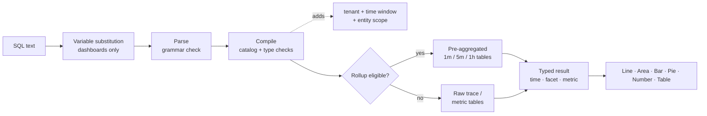

## How to query with SQL: the mechanics of querying {#how-to-query-with-sql-the-mechanics-of-querying}

Before you use any tool, it helps to know how it works. This doc shows how to explore your data, explains what happens when a query runs, and walks through example queries from simple to complex.

### Data exploration

The best way to use SQL is to open **Explore** and try it on your own data.

>[!TIP]
>
> SQL is read-only. It can't change or delete data, and every query is scoped to your tenant.

1. **Pick a customer** in the tenant switcher at the top of the app, SQL needs a single tenant.
2. Open **Explore**. The **Visual Builder** tab lets you pick **From** (an entity), **Aggregate**, **Filters**, **Facet** and **Timeseries**. The generated SQL appears underneath.
3. Switch to the **SQL** tab to edit the query directly. The editor autocompletes entities, attributes and functions as you type.
4. Open the **Query guide** panel on the right to browse entities, attribute types and example queries. Click an example to load it.
5. Click **Validate** to check a query without running it, or **Run** (⌘/Ctrl + Enter) to see the results.

Start by typing `FROM` and choosing an entity, then add `SELECT` and an attribute:

```sql
FROM Transaction SELECT name, duration LIMIT 20
```

This is a basic **event query**. It returns 20 inbound requests, showing the operation name and duration of each one.

Now replace the attributes with an **aggregate** and group the result:

```sql
FROM Transaction SELECT count(*) FACET service
```

This counts requests per service, which shows you which services are reporting.

>[!IMPORTANT]
>
> **Discover before you build.** Attribute availability depends on how each service is instrumented. Run the [discovery queries](#101-data-discovery) on a new tenant first to see which services, hosts, attributes and metrics actually contain data.

### How a query runs

When you run a query, Observability Insights:

1. **Substitutes variables**, replacing `{{name}}` tokens with the current dashboard variable selection. This happens in the browser, on dashboards only.
2. **Parses** the text. Anything outside the SQL grammar is rejected, including semicolons, raw SQL functions and subqueries.
3. **Compiles** the query. It maps each logical attribute (for example `urlPath`) to its stored expression and validates types and functions.
4. **Adds mandatory guards**: your tenant, the time window, and the entity's fixed scope (for example, `Transaction` means server spans only).
5. **Routes** eligible time-series queries to pre-aggregated **rollup** tables. This is automatic, and the results match the raw data.
6. **Executes** the query with a 15-second timeout and a bytes-read budget, then returns typed columns (time, facet, metric) that the UI renders.



### Result shapes

Every query returns one of four shapes. The shape decides which charts make sense.

| Shape           | How you get it                                       | Default `LIMIT` | Best visualization |
| --------------- | ---------------------------------------------------- | --------------- | ------------------ |
| **Billboard**   | Aggregates only, with no `FACET` and no `TIMESERIES` | 1               | Number             |
| **Facet**       | Aggregates + `FACET`                                 | 10              | Bar, Pie, Table    |
| **Time series** | Aggregates + `TIMESERIES` (with or without `FACET`)  | 5,000 rows      | Line, Area, Bar    |
| **Events**      | Raw attributes only                                  | 100             | Table              |

<a id="time-window-precedence"></a>

### Time window precedence

| Where the query runs              | Which window applies                                                               |
| --------------------------------- | ---------------------------------------------------------------------------------- |
| **Dashboard widget**              | The dashboard **time picker**. `SINCE`/`UNTIL` in the query are ignored.           |
| **Add widget preview**            | The time picker inside the **Add widget** dialog.                                  |
| **Explore**                       | The global time picker. `SINCE`/`UNTIL` are ignored when a picker range is active. |
| **API without an explicit range** | `SINCE`/`UNTIL` in the query, defaulting to the last hour.                         |

>[!NOTE]
>
> Because the picker wins on dashboards and in Explore, this guide usually leaves `SINCE` out of dashboard queries. One should always define a time picker for the queries.
